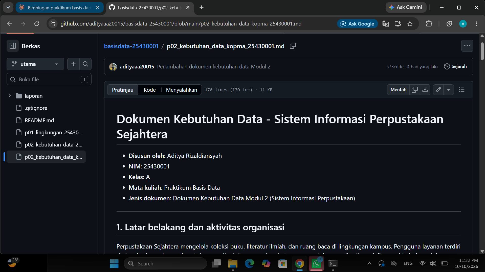
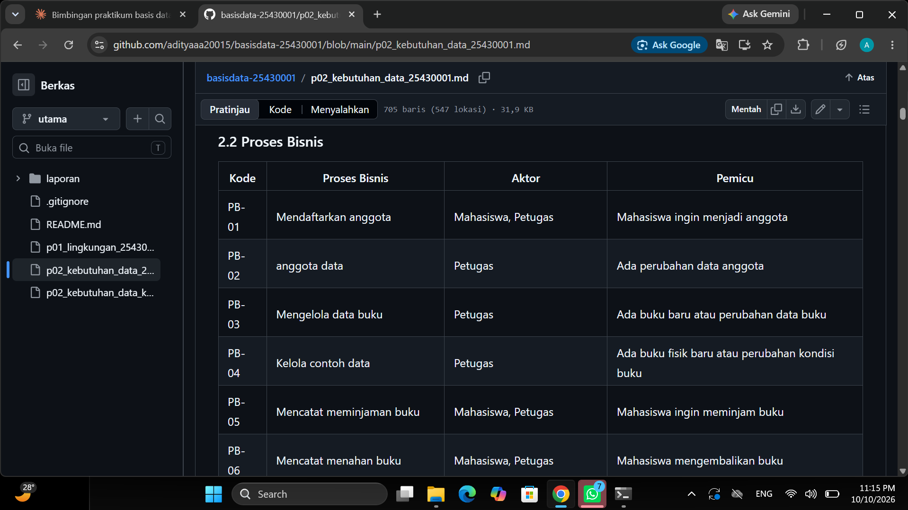
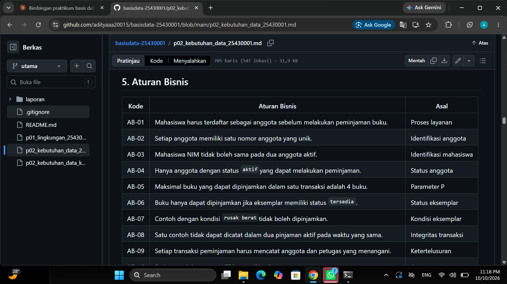
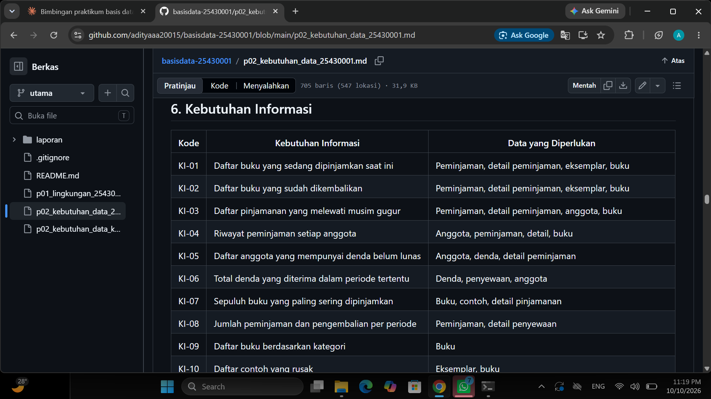
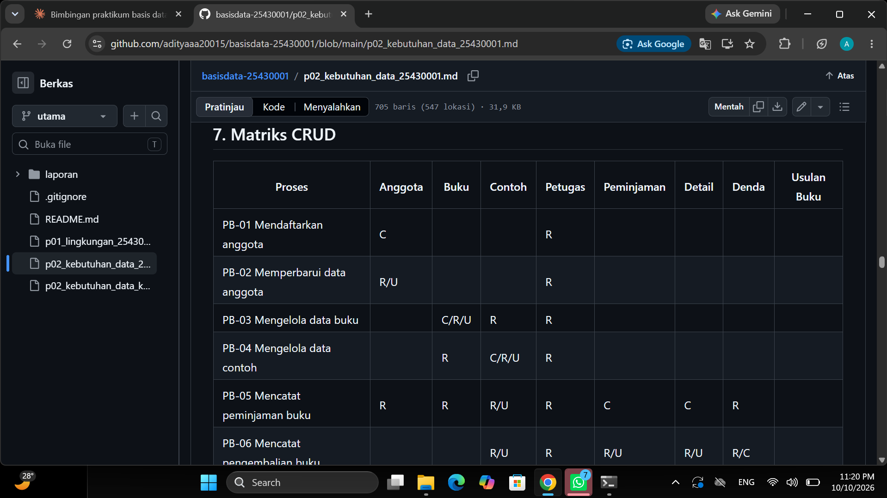
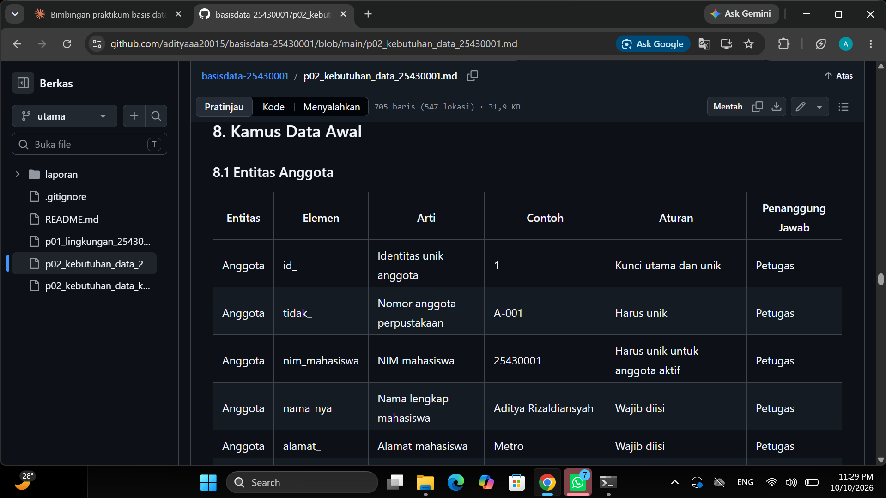
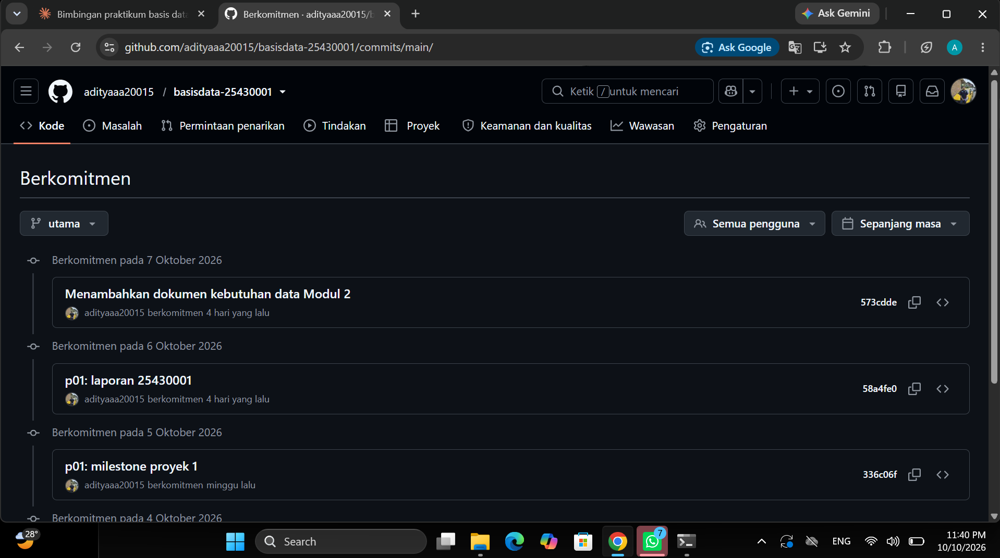

# Laporan Praktikum Basis Data - Pertemuan 02

**Nama:** Aditya Rizaldiansyah  
**NIM:** 25430001  
**Kelas:** A  
**Tanggal:** 10 october 2026 
**Dosen:** Dedi Irawan S.kom,M.ti

---

## 1. Tujuan Praktikum

Tujuan praktikum ini adalah memahami cara mengumpulkan dan menyusun kebutuhan data sebelum membuat database. Melalui kegiatan ini, saya belajar mengidentifikasi aktor, proses bisnis, dokumen sumber, entitas, atribut, aturan bisnis, kebutuhan informasi, dan matriks CRUD. Saya juga belajar menyusun kamus data serta memperhatikan kebutuhan non-fungsional seperti volume, retensi, dan privasi data. Hasil akhirnya adalah dokumen kebutuhan data yang bisa dijadikan dasar untuk tahap perancangan database berikutnya.

## 2. Ringkasan Dasar Teori

Kebutuhan data merupakan informasi tentang data yang perlu disimpan dan dikelola agar kegiatan suatu organisasi bisa berjalan dengan baik. Analisis dimulai dengan memahami aktivitas organisasi dan pihak yang terlibat, kemudian melihat dokumen yang digunakan dalam kegiatan sehari-hari. Dari dokumen tersebut, elemen data dipilah menjadi data yang perlu disimpan, data yang bisa dihitung, dan data yang dapat ditampilkan dari entitas lain.

Entitas adalah objek yang datanya perlu dikelola, sedangkan atribut adalah keterangan yang dimiliki oleh entitas tersebut. Aturan bisnis menjelaskan batasan yang harus dipatuhi, misalnya nomor transaksi harus unik atau jumlah barang tidak boleh melebihi stok. Kebutuhan informasi menjelaskan laporan atau informasi yang harus bisa dihasilkan dari database. Matriks CRUD digunakan untuk melihat proses mana yang membuat, membaca, memperbarui, atau menghapus data. Kamus data kemudian menjelaskan arti atribut, contoh nilai, aturan, dan pihak yang bertanggung jawab. Selain itu, rancangan data perlu memperhatikan volume, lama penyimpanan, privasi, dan kualitas data agar data yang dihasilkan tetap dapat dipercaya.

## 3. Hasil Langkah Percobaan

### D.2 Aktor dan proses bisnis Kopma

Berdasarkan pemahaman saya, proses bisnis perlu ditulis dengan menyebutkan siapa yang melakukan aktivitas, apa kegiatannya, dan apa yang memicu kegiatan tersebut. Untuk contoh kasus Kopma, aktivitas utamanya berkaitan dengan transaksi penjualan barang, pengelolaan stok, pencatatan anggota, dan pembuatan laporan. Aktor yang terlibat harus dibedakan supaya tanggung jawab masing-masing tidak tercampur.

| Kode | Proses bisnis | Aktor | Pemicu |
|---|---|---|---|
| PB-01 | Mendaftarkan anggota Kopma | Petugas administrasi | Mahasiswa ingin menjadi anggota |
| PB-02 | Mengelola data barang | Petugas stok | Ada barang baru atau perubahan informasi barang |
| PB-03 | Mencatat transaksi penjualan | Kasir | Pembeli akan membeli barang |
| PB-04 | Mencatat pembayaran | Kasir | Pembeli membayar barang yang dibeli |
| PB-05 | Memperbarui stok barang | Kasir / Petugas stok | Terjadi penjualan atau penerimaan barang |
| PB-06 | Mengelola data pemasok | Petugas pengadaan | Ada pemasok baru atau perubahan data pemasok |
| PB-07 | Mencatat pembelian barang dari pemasok | Petugas pengadaan | Stok perlu ditambah atau barang dipesan |
| PB-08 | Mengelola poin loyalitas anggota | Kasir / Petugas administrasi | Anggota memperoleh atau menukarkan poin |
| PB-09 | Memeriksa laporan penjualan | Ketua / Pengelola Kopma | Pengelola memerlukan rekap penjualan |
| PB-10 | Menyusun laporan stok dan pengadaan | Petugas stok / Pengelola Kopma | Perlu mengetahui stok atau kebutuhan pengadaan |

Dari tabel tersebut, saya memahami bahwa satu proses bisa membaca beberapa entitas sekaligus. Contohnya, saat transaksi penjualan, kasir perlu melihat data barang dan data anggota jika pembeli menggunakan keanggotaan, lalu mencatat transaksi dan detail barang yang dibeli. Nama aktor dan proses di atas merupakan draf analisis kasus Kopma dan perlu dicocokkan kembali dengan skenario yang tertulis di modul praktikum.

### D.3 Dokumen sumber (nota) Kopma

Dokumen sumber yang dianalisis untuk contoh ini adalah nota penjualan. Nota dipilih karena memuat informasi yang muncul ketika pembeli melakukan transaksi, seperti nomor nota, tanggal, kasir, barang yang dibeli, jumlah, harga, total pembayaran, dan uang kembalian.

Contoh rancangan nota:

~~~text
==================================================
                 KOPMA MAHASISWA
                    NOTA PENJUALAN
==================================================
No. Nota       : KPM-001
Tanggal        : [tanggal transaksi]
Kasir          : [nama kasir]
ID Anggota     : [jika ada]
--------------------------------------------------
| No | Kode Barang | Nama Barang | Qty | Harga   |
|----|-------------|-------------|-----|---------|
| 1  | BRG-001     | Buku Tulis  | 2   | 5000    |
| 2  | BRG-002     | Pulpen      | 1   | 3000    |
--------------------------------------------------
Subtotal       : Rp13.000
Diskon         : Rp[nominal]
Total          : Rp[nominal]
Pembayaran     : Rp[nominal]
Kembalian      : Rp[nominal]
Poin Diperoleh : [jumlah poin]
==================================================
           Terima kasih telah berbelanja
==================================================
~~~

Nota di atas merupakan contoh untuk membantu menjelaskan elemen data, bukan salinan dokumen resmi Kopma. Nilai harga dan barang perlu diganti jika modul memberikan contoh transaksi yang berbeda.

| Elemen pada dokumen | Disimpan / dihitung / ditampilkan | Keterangan |
|---|---|---|
| Nomor nota | Disimpan | Identitas unik satu transaksi penjualan |
| Tanggal dan waktu | Disimpan | Menunjukkan kapan transaksi dilakukan |
| Nama kasir | Ditampilkan dari data lain | Bisa diperoleh dari data pegawai/kasir melalui ID kasir |
| ID anggota | Disimpan jika transaksi memakai keanggotaan | Menghubungkan transaksi dengan anggota yang memperoleh poin |
| Kode barang | Disimpan pada detail transaksi | Menunjukkan barang yang dibeli |
| Nama barang | Ditampilkan dari data barang | Tidak perlu ditulis ulang sebagai data utama jika sudah tersedia di katalog |
| Jumlah barang | Disimpan | Mencatat jumlah barang yang dibeli |
| Harga satuan saat transaksi | Disimpan | Perlu dicatat agar riwayat transaksi tidak berubah ketika harga katalog berubah |
| Subtotal per barang | Dihitung | Jumlah barang dikalikan harga satuan |
| Total transaksi | Dihitung dan dapat disimpan sebagai nilai transaksi | Diperoleh dari subtotal dikurangi diskon atau ditambah biaya lain jika ada |
| Uang pembayaran | Disimpan | Mencatat uang yang dibayarkan pembeli |
| Kembalian | Dihitung | Uang pembayaran dikurangi total transaksi |
| Poin diperoleh | Dihitung dan dicatat sebagai transaksi poin | Bergantung pada aturan loyalitas yang dipakai |

### D.4 Entitas kandidat dan aturan bisnis Kopma

Dari nota dan kegiatan yang dijelaskan dalam contoh kasus, entitas awal yang dapat dipertimbangkan adalah Anggota, Pegawai, Barang, Penjualan, Detail Penjualan, Pemasok, Pengadaan, Detail Pengadaan, dan Transaksi Poin. Entitas tersebut masih berupa kandidat dan dapat disesuaikan jika hasil analisis modul menunjukkan kebutuhan yang berbeda.

| Entitas kandidat | Elemen data utama | Sumber |
|---|---|---|
| Anggota | id_anggota, nim_anggota, nama_anggota, no_hp, status_anggota, tanggal_daftar | Formulir anggota |
| Pegawai | id_pegawai, kode_pegawai, nama_pegawai, peran, status_pegawai | Data pegawai |
| Barang | id_barang, kode_barang, nama_barang, kategori, harga_jual, stok, batas_minimum | Katalog barang |
| Penjualan | id_penjualan, no_nota, tanggal_waktu, id_pegawai, id_anggota, total, pembayaran, kembalian | Nota penjualan |
| Detail Penjualan | id_detail_penjualan, id_penjualan, id_barang, jumlah, harga_satuan, subtotal | Rincian nota |
| Pemasok | id_pemasok, nama_pemasok, no_telepon, alamat | Data pemasok |
| Pengadaan | id_pengadaan, tanggal_pengadaan, id_pemasok, id_pegawai, total_pengadaan | Dokumen pengadaan |
| Detail Pengadaan | id_detail_pengadaan, id_pengadaan, id_barang, jumlah, harga_beli | Rincian pembelian barang |
| Transaksi Poin | id_transaksi_poin, id_anggota, id_penjualan, tanggal_transaksi, jenis_transaksi, jumlah_poin | Riwayat poin loyalitas |

#### Aturan bisnis awal

| Kode | Aturan bisnis | Asal |
|---|---|---|
| AB-01 | Setiap transaksi penjualan memiliki nomor nota yang unik. | Nota penjualan |
| AB-02 | Satu transaksi penjualan memiliki minimal satu baris detail barang. | Struktur transaksi |
| AB-03 | Jumlah barang yang dijual harus lebih dari nol. | Validasi transaksi |
| AB-04 | Penjualan hanya dapat diproses jika stok barang mencukupi. | Pengelolaan stok |
| AB-05 | Stok barang berkurang setelah transaksi penjualan berhasil diselesaikan. | Proses penjualan |
| AB-06 | Data transaksi harus menyimpan harga satuan yang digunakan saat penjualan. | Ketertelusuran harga |
| AB-07 | Subtotal detail dihitung dari jumlah barang dikalikan harga satuan. | Perhitungan transaksi |
| AB-08 | Total transaksi dihitung dari penjumlahan subtotal dan penyesuaian yang berlaku. | Perhitungan transaksi |
| AB-09 | Data kasir yang menangani transaksi harus dapat ditelusuri. | Kontrol transaksi |
| AB-10 | NIM atau nomor anggota harus unik jika digunakan untuk mengenali anggota. | Identifikasi anggota |
| AB-11 | Poin loyalitas hanya diberikan sesuai transaksi yang memenuhi aturan program. | Aturan loyalitas |
| AB-12 | Setiap penambahan atau penukaran poin dicatat sebagai transaksi agar riwayatnya bisa dilihat kembali. | Ketertelusuran poin |
| AB-13 | Stok tidak boleh menjadi nilai negatif. | Validasi stok |
| AB-14 | Data pemasok dicatat sebelum digunakan pada transaksi pengadaan. | Proses pengadaan |
| AB-15 | Transaksi yang telah selesai tetap disimpan untuk laporan dan pemeriksaan kembali. | Retensi data |

#### Pemisahan entitas

Entitas **Penjualan** dan **Detail Penjualan** dipisahkan karena satu nota bisa memuat beberapa jenis barang. Informasi yang berlaku untuk satu nota, seperti tanggal dan kasir, disimpan pada Penjualan. Sementara itu, barang, jumlah, dan harga satuan dicatat per baris pada Detail Penjualan.

Entitas **Barang** dan **Detail Penjualan** juga memiliki fungsi berbeda. Barang menyimpan informasi katalog dan stok terkini, sedangkan Detail Penjualan menyimpan informasi barang pada saat transaksi berlangsung. Harga satuan tetap dicatat pada detail transaksi supaya laporan lama tidak berubah saat harga barang diperbarui.

Riwayat poin dibuat sebagai **Transaksi Poin** tersendiri supaya perolehan dan penukaran poin sama-sama dapat ditelusuri. Saldo poin bisa dihitung dari total poin yang diperoleh dikurangi total poin yang ditukarkan, sehingga riwayat transaksi tetap menjadi sumber perhitungannya.

### D.5 Kebutuhan informasi dan matriks CRUD Kopma

Kebutuhan informasi menjelaskan laporan apa yang perlu disediakan database untuk membantu kegiatan Kopma. Daftar berikut merupakan draf awal yang diturunkan dari proses penjualan, stok, pengadaan, anggota, dan poin loyalitas.

| Kode | Kebutuhan informasi | Data yang diperlukan |
|---|---|---|
| KI-01 | Total penjualan per hari atau per bulan | Penjualan, Detail Penjualan |
| KI-02 | Daftar barang yang paling banyak terjual | Barang, Detail Penjualan, Penjualan |
| KI-03 | Daftar barang dengan stok di bawah batas minimum | Barang |
| KI-04 | Riwayat transaksi berdasarkan kasir | Pegawai, Penjualan |
| KI-05 | Daftar transaksi berdasarkan anggota | Anggota, Penjualan, Detail Penjualan |
| KI-06 | Jumlah pemasukan penjualan dalam periode tertentu | Penjualan |
| KI-07 | Daftar barang yang perlu dipesan kembali | Barang, Pengadaan, Detail Pengadaan |
| KI-08 | Riwayat pembelian barang dari pemasok | Pemasok, Pengadaan, Detail Pengadaan |
| KI-09 | Saldo poin setiap anggota | Anggota, Transaksi Poin |
| KI-10 | Daftar anggota dengan poin terbanyak | Anggota, Transaksi Poin |
| KI-11 | Riwayat penukaran poin anggota | Anggota, Transaksi Poin |
| KI-12 | Laporan penjualan dan stok untuk pengelola | Barang, Penjualan, Detail Penjualan, Pengadaan |

#### Matriks CRUD awal

| Proses | Anggota | Pegawai | Barang | Penjualan | Detail Penjualan | Pemasok | Pengadaan | Detail Pengadaan | Transaksi Poin |
|---|---|---|---|---|---|---|---|---|---|
| PB-01 Mendaftarkan anggota | C | | | | | | | | |
| PB-02 Mengelola data barang | | R | C/R/U | | | | | | |
| PB-03 Mencatat penjualan | R | R | R/U | C | C | | | | C |
| PB-04 Mencatat pembayaran | R | R | | R/U | R | | | | |
| PB-05 Memperbarui stok | | R | R/U | | | | R | R | |
| PB-06 Mengelola data pemasok | | R | | | | C/R/U | | | |
| PB-07 Mencatat pengadaan | | R | R/U | | | R | C | C | |
| PB-08 Mengelola poin loyalitas | R | R | | R | | | | | C |
| PB-09 Memeriksa laporan penjualan | R | R | R | R | R | | R | R | R |
| PB-10 Menyusun laporan stok/pengadaan | | R | R | | | R | R | R | |

Keterangan: **C** berarti membuat data, **R** berarti membaca data, **U** berarti memperbarui data, dan **D** berarti menghapus data. Pada rancangan ini operasi Delete tidak banyak digunakan untuk transaksi karena data transaksi lebih baik dipertahankan sebagai riwayat. Apabila ada salah input, koreksi sebaiknya dilakukan dengan mekanisme pembatalan atau pencatatan koreksi yang tetap bisa ditelusuri, sesuai kebijakan organisasi.

### D.6 Kamus data awal dan kebutuhan non-fungsional Kopma

Kamus data awal digunakan untuk menyamakan pengertian setiap atribut sehingga nama kolom dan aturan pengisiannya tidak membingungkan ketika database dibuat.

| Entitas | Elemen | Arti | Contoh | Aturan | Penanggung jawab |
|---|---|---|---|---|---|
| Anggota | id_anggota | Identitas unik anggota | AG-001 | Unik dan tidak kosong | Petugas administrasi |
| Anggota | nim_anggota | NIM anggota | 25430001 | Unik jika anggota adalah mahasiswa | Petugas administrasi |
| Anggota | nama_anggota | Nama anggota | Aditya Rizaldiansyah | Wajib diisi | Petugas administrasi |
| Pegawai | id_pegawai | Identitas pegawai | PG-001 | Unik | Pengelola |
| Pegawai | peran | Tugas pegawai | kasir | Mengikuti daftar peran yang ditetapkan | Pengelola |
| Barang | id_barang | Identitas barang | BRG-001 | Unik | Petugas stok |
| Barang | nama_barang | Nama barang yang dijual | Buku Tulis | Wajib diisi | Petugas stok |
| Barang | harga_jual | Harga jual barang | 5000 | Nilai tidak boleh negatif | Petugas stok |
| Barang | stok | Jumlah stok yang tersedia | 25 | Bilangan bulat dan minimal 0 | Petugas stok |
| Penjualan | no_nota | Nomor transaksi penjualan | KPM-001 | Harus unik | Kasir |
| Penjualan | tanggal_waktu | Waktu transaksi | 2026-10-10 10:30 | Format waktu valid | Kasir |
| Penjualan | total | Total yang harus dibayar | 13000 | Tidak boleh negatif | Kasir |
| Detail Penjualan | jumlah | Kuantitas barang yang dibeli | 2 | Bilangan bulat lebih dari 0 | Kasir |
| Detail Penjualan | harga_satuan | Harga per barang saat transaksi | 5000 | Disimpan pada waktu penjualan | Kasir |
| Detail Penjualan | subtotal | Jumlah dikalikan harga satuan | 10000 | Sesuai perhitungan | Sistem / Kasir |
| Pemasok | id_pemasok | Identitas pemasok | SUP-001 | Unik | Petugas pengadaan |
| Pemasok | nama_pemasok | Nama pemasok | Toko Grosir | Wajib diisi | Petugas pengadaan |
| Pengadaan | id_pengadaan | Identitas pengadaan barang | PB-001 | Unik | Petugas pengadaan |
| Pengadaan | tanggal_pengadaan | Tanggal pemesanan/penerimaan | 2026-10-10 | Tanggal valid | Petugas pengadaan |
| Transaksi Poin | id_transaksi_poin | Identitas transaksi poin | TP-001 | Unik | Petugas administrasi |
| Transaksi Poin | jenis_transaksi | Jenis pencatatan poin | perolehan | Nilai mengikuti domain yang ditetapkan | Petugas administrasi |
| Transaksi Poin | jumlah_poin | Banyak poin pada transaksi | 2 | Bilangan bulat positif | Petugas administrasi |

#### Kebutuhan non-fungsional

- **Volume data:** data penjualan dan stok akan bertambah seiring kegiatan Kopma. Jumlah transaksi per hari perlu dihitung berdasarkan kegiatan sebenarnya atau asumsi yang ditentukan di modul.
- **Retensi:** data transaksi penjualan, pengadaan, dan poin perlu dipertahankan agar dapat digunakan untuk laporan dan pemeriksaan kembali. Lama retensi final mengikuti ketentuan praktikum atau kebijakan organisasi.
- **Privasi:** nomor telepon dan data anggota tidak boleh ditampilkan kepada pihak yang tidak membutuhkan. Akses ke data anggota dan laporan harus disesuaikan dengan peran pengguna.
- **Keamanan:** pengguna perlu mempunyai hak akses sesuai tugasnya. Kasir tidak harus mempunyai kewenangan untuk mengubah seluruh data pegawai atau konfigurasi sistem.
- **Integritas:** stok tidak boleh menjadi negatif, nomor nota tidak boleh ganda, dan jumlah detail harus lebih dari nol.
- **Pencadangan:** data perlu dicadangkan secara berkala agar tidak hilang jika perangkat atau file database mengalami masalah.

### D.7 Dokumen kebutuhan data Kopma

Setelah proses bisnis, dokumen sumber, entitas, aturan bisnis, kebutuhan informasi, matriks CRUD, dan kamus data disusun, hasilnya digabungkan menjadi satu dokumen kebutuhan data. Menurut saya, penggabungan ini memudahkan pemeriksaan karena hubungan antara aktivitas organisasi dan data yang diperlukan dapat dilihat dalam satu tempat.

**Keterangan gambar:** tangkapan layar seharusnya memperlihatkan nama file dan isi dokumen yang sudah diunggah ke repository. Pastikan gambar ini benar-benar diambil dari repository yang sesuai dengan kasus Kopma dan bukan dari file proyek perpustakaan.

---

## 4. Jawaban Titik Analisis

> **Catatan:** pertanyaan Titik Analisis 1–3 tidak dicantumkan secara lengkap pada kerangka yang dikirim. Jawaban di bawah merupakan draf berdasarkan topik analisis kebutuhan data. Cocokkan dengan pertanyaan asli di modul sebelum dikumpulkan.

**Titik Analisis 1**

Menurut saya, data pada dokumen sumber perlu dipisahkan antara data yang benar-benar disimpan dan data yang hanya dihitung atau ditampilkan. Nomor nota, tanggal transaksi, kasir, barang yang dibeli, jumlah, dan harga saat transaksi perlu dicatat. Sementara itu, nama barang dapat ditampilkan dari katalog dan subtotal dapat dihitung dari jumlah dikalikan harga satuan. Pemisahan ini mengurangi pengulangan data, tetapi harga saat transaksi tetap perlu disimpan agar riwayat penjualan tidak berubah ketika harga katalog diperbarui.

**Titik Analisis 2**

Entitas Penjualan dan Detail Penjualan sebaiknya dipisahkan karena satu transaksi dapat berisi beberapa barang. Jika seluruh informasi disimpan dalam satu tabel tanpa struktur detail, kolom barang bisa berulang atau jumlah barang dalam satu transaksi menjadi sulit ditangani. Dengan tabel detail, satu nomor nota dapat dihubungkan ke banyak baris barang sehingga data lebih rapi dan mudah dihitung.

**Titik Analisis 3**

Matriks CRUD membantu memeriksa apakah setiap proses bisnis sudah memiliki akses data yang sesuai. Misalnya, proses penjualan harus membaca data barang, membuat data penjualan dan detailnya, lalu memperbarui stok. Jika suatu proses membutuhkan data tetapi tidak mempunyai operasi Read, proses tersebut perlu diperiksa lagi. Saya juga memahami bahwa operasi Delete tidak selalu perlu diberikan pada transaksi karena riwayat penjualan dan pembayaran harus tetap dapat ditelusuri.

**Perhitungan parameter P**

Dua digit terakhir NIM saya adalah **01**. Dengan rumus parameter yang digunakan pada proyek, hasilnya sebagai berikut:

~~~text
P = (01 mod 9) + 1
P = 1 + 1
P = 2
~~~

Jadi, nilai parameter **P = 2**. Untuk proyek perpustakaan Nexus Pustaka AR, parameter ini menghasilkan batas maksimal peminjaman sebanyak `P + 2 = 4` buku, denda keterlambatan sebesar `P` ribu atau **Rp2.000 per hari per buku**, serta perkiraan aktivitas sebanyak `40 + (5 × P) = 50 transaksi per hari`. Nilai ini perlu digunakan konsisten pada dokumen kebutuhan data proyek.

---

## 5. Hasil Latihan dan Modifikasi

**Latihan E.1 (poin loyalitas)**

Menurut saya, poin loyalitas harus dicatat sebagai riwayat transaksi, bukan hanya sebagai angka yang bisa diubah langsung. Dengan cara ini, penambahan dan penukaran poin dapat diperiksa kembali apabila terjadi perbedaan saldo. Sebagai rancangan awal, anggota memperoleh **1 poin untuk setiap Rp10.000 transaksi yang sudah dibayar**. Poin hanya diberikan untuk transaksi yang selesai dan tidak dibatalkan. Poin yang ditukarkan dicatat sebagai transaksi baru dengan jenis `penukaran`, sedangkan transaksi perolehan dicatat dengan jenis `perolehan`.

Saldo poin dihitung dari total poin perolehan dikurangi total poin penukaran. Sebelum penukaran disetujui, sistem harus memeriksa saldo anggota terlebih dahulu agar jumlah poin yang digunakan tidak melebihi saldo yang tersedia. Aturan 1 poin untuk setiap Rp10.000 merupakan usulan modifikasi saya; apabila modul menetapkan rumus atau ambang penukaran yang berbeda, gunakan aturan yang sesuai dengan modul.

**Contoh:** jika transaksi yang memenuhi syarat bernilai Rp35.000, anggota memperoleh 3 poin apabila perhitungan menggunakan satu poin untuk setiap kelipatan penuh Rp10.000. Jika anggota sebelumnya memiliki 10 poin dan menukarkan 4 poin, saldo akhirnya menjadi 9 poin.

**Latihan E.2 (tiga pernyataan kebutuhan kabur)**

Pernyataan kebutuhan yang terlalu umum perlu diperbaiki agar bisa diuji. Berikut tiga contoh perbaikan yang menurut saya lebih jelas.

1. **Pernyataan kabur:** “Sistem harus mudah digunakan.”

   **Perbaikan:** “Kasir harus dapat memilih barang, memasukkan jumlah, memeriksa total, dan menyimpan transaksi tanpa bantuan teknis setelah mendapat pelatihan singkat. Keberhasilan tugas diuji menggunakan skenario transaksi yang sudah ditentukan.”

2. **Pernyataan kabur:** “Sistem harus cepat.”

   **Perbaikan:** “Pada kondisi penggunaan normal, pencarian barang berdasarkan kode atau nama harus menampilkan hasil dalam waktu maksimal 2 detik untuk sedikitnya 95% permintaan.”

3. **Pernyataan kabur:** “Data harus aman.”

   **Perbaikan:** “Sistem harus membatasi akses berdasarkan peran pengguna, menyimpan kata sandi dalam bentuk hash, dan menyediakan pencadangan data secara berkala. Kasir hanya boleh mengakses fungsi yang diperlukan untuk transaksi, sedangkan pengaturan pegawai dan laporan pengelolaan dibatasi kepada pengguna yang berwenang.”

Ketiga perbaikan ini lebih mudah dipahami dan diuji karena menjelaskan perilaku sistem yang diharapkan. Angka dan rincian teknisnya merupakan usulan awal sehingga perlu disesuaikan jika modul memberikan standar yang berbeda.

---

## 6. Tugas Mandiri: Milestone Proyek 02

Pada tugas mandiri, saya menyusun dokumen kebutuhan data untuk **Nexus Pustaka AR**, yaitu perpustakaan kampus yang melayani mahasiswa aktif. Sistem yang dirancang mencakup data anggota, buku, eksemplar, petugas, peminjaman, detail peminjaman, denda, dan usulan buku. Saya memisahkan data Buku dan Eksemplar karena satu judul dapat memiliki beberapa salinan fisik, serta memisahkan Peminjaman dan Detail Peminjaman karena satu transaksi bisa berisi beberapa buku.

### 6.1 Aktor dan proses bisnis

**Keterangan:** gambar ini perlu memperlihatkan bagian aktor dan tabel proses bisnis pada dokumen proyek di GitHub. Pada bagian ini saya menetapkan kegiatan seperti pendaftaran anggota, pengelolaan koleksi, peminjaman, pengembalian, pencatatan denda, pengelolaan usulan buku, dan pembuatan laporan.

### 6.2 Aturan bisnis

**Keterangan:** aturan bisnis digunakan untuk menjelaskan batasan dalam kegiatan perpustakaan. Di antaranya, hanya anggota aktif yang dapat meminjam, eksemplar harus tersedia dan layak dipinjam, setiap transaksi harus mencatat petugas, dan tarif denda perlu disimpan pada transaksi agar riwayat tidak berubah ketika tarif diperbarui.

### 6.3 Kebutuhan informasi

**Keterangan:** kebutuhan informasi disusun berdasarkan data yang nantinya perlu dicari atau dilaporkan, seperti daftar buku yang sedang dipinjam, peminjaman yang terlambat, riwayat anggota, denda yang belum lunas, koleksi yang rusak, dan usulan buku dari mahasiswa.

### 6.4 Matriks CRUD

**Keterangan:** matriks CRUD digunakan untuk melihat hubungan setiap proses bisnis dengan entitas. Saya memeriksa apakah proses yang dilakukan sudah mempunyai akses Create, Read, dan Update yang diperlukan. Penghapusan data transaksi dibatasi karena riwayat peminjaman dan denda masih diperlukan untuk pemeriksaan.

### 6.5 Kamus data awal

**Keterangan:** kamus data menjelaskan arti atribut, contoh nilai, aturan pengisian, dan pihak yang bertanggung jawab. Bagian ini membantu supaya nama kolom dan penggunaannya tidak ditafsirkan berbeda ketika database mulai dibuat.

### 6.6 Dokumen proyek di GitHub

Dokumen kebutuhan data proyek disimpan dalam file `p02_kebutuhan_data_25430001.md` di repository. File tersebut berisi latar belakang organisasi, proses bisnis, dokumen sumber, entitas kandidat, aturan bisnis, kebutuhan informasi, matriks CRUD, kamus data, kebutuhan non-fungsional, dan isu kualitas data.

Saat mengambil tangkapan layar, saya perlu memastikan isi file terlihat jelas, nama repository atau akun GitHub dapat dikenali, serta jam sistem terlihat jika itu menjadi syarat pengumpulan.

---

## 7. Pembahasan dan Kendala

Dari praktikum ini, saya memahami bahwa membuat database tidak cukup hanya menentukan tabel dan kolom. Saya perlu memahami kegiatan organisasi terlebih dahulu supaya data yang disimpan benar-benar sesuai dengan kebutuhan. Dokumen sumber membantu mengetahui informasi yang digunakan saat transaksi, sedangkan aturan bisnis membantu menentukan validasi yang perlu dilakukan.

Salah satu bagian yang perlu diperhatikan adalah menentukan apakah sebuah nilai harus disimpan atau dihitung. Contohnya, subtotal dapat dihitung dari jumlah dan harga satuan. Namun harga satuan pada saat transaksi tetap perlu dicatat agar riwayat transaksi tidak ikut berubah ketika harga di katalog diperbarui. Saya juga melihat bahwa pemisahan data transaksi utama dan detail transaksi membuat struktur lebih mudah dikelola.

Kendala yang mungkin muncul adalah menentukan batas antara data yang dihitung dan data yang harus disimpan, memastikan hubungan antarentitas tepat, serta mengisi matriks CRUD secara konsisten dengan proses bisnis. Selain itu, gambar bukti GitHub perlu diambil setelah file benar-benar diunggah sehingga tangkapan layar menunjukkan hasil yang sesuai dengan dokumen. Untuk mengurangi kesalahan, saya memeriksa kembali nama entitas, atribut, aturan bisnis, dan kebutuhan informasi sebelum dokumen dikumpulkan.

## 8. Kesimpulan

Praktikum pertemuan 02 membantu saya memahami langkah awal dalam merancang database melalui analisis kebutuhan data. Saya belajar menghubungkan proses bisnis dengan dokumen sumber, entitas, aturan bisnis, kebutuhan informasi, matriks CRUD, dan kamus data. Dokumen kebutuhan data yang disusun dapat digunakan sebagai dasar untuk melanjutkan tahap perancangan database, tetapi isi akhirnya tetap perlu diperiksa agar sesuai dengan modul dan aturan yang ditetapkan dosen.

## 9. Pernyataan Penggunaan AI

Saya menggunakan bantuan AI untuk membantu menyusun kerangka tulisan, merapikan bahasa, dan mendapatkan contoh cara menjelaskan konsep kebutuhan data. Isi akhir tetap saya periksa dan sesuaikan dengan hasil praktikum, modul, serta keputusan desain proyek yang saya gunakan. Saya bertanggung jawab untuk memastikan informasi, tabel, parameter, dan bukti yang dikumpulkan benar-benar sesuai dengan pekerjaan saya.

## 10. Bukti Git

- **Repository:** https://github.com/adityaaa20015/basisdata-25430001
- **Commit dokumen kebutuhan data:** `573cdde` - `dokumen kebutuhan data (Kopma dan proyek)`
- **Commit laporan:** `[isi hash commit setelah laporan di-commit]` - `p02: laporan praktikum`

**Keterangan:** setelah file laporan di-commit dan di-push, ambil tangkapan layar halaman commit GitHub. Pastikan hash commit dan pesan commit terlihat. Ganti placeholder hash di atas menggunakan hash yang benar dari repository.

---

## Checklist

| Butir | Status |
|---|---|
| Identitas (nama, NIM, kelas, pertemuan, tanggal, asisten/dosen) | ✅ |
| Tujuan (bahasa sendiri, maksimal 5 baris) | ✅ |
| Ringkasan teori (maksimal setengah halaman, tanpa menyalin) | ✅ |
| Hasil langkah D (tabel/tangkapan layar + keterangan) | ✅ |
| Titik Analisis 1–3 dijawab dengan alasan sesuai soal modul | ✅ |
| Latihan E (poin loyalitas + tiga pernyataan diperbaiki) | ✅ |
| Tugas Mandiri F (berkas, bukti, dan keputusan desain) | ✅ |
| Pembahasan dan kendala | ✅ |
| Kesimpulan (2–4 kalimat) | ✅ |
| Pernyataan Penggunaan AI | ✅ |
| Bukti Git (tautan dan hash commit) | ✅ |
| Keaslian (akun ber-NIM dan jam sistem pada setiap gambar) | ✅ |
| File `p02_kebutuhan_data_kopma_25430001.md` dan `p02_kebutuhan_data_25430001.md` tersedia dan sesuai kasusnya | ✅ |
| Tabel PB, AB, KI, matriks CRUD, dan kamus data ada di berkas proyek | ✅ |
| Titik Analisis 1–3, perhitungan parameter P, dan perbaikan tiga pernyataan kabur sudah dicocokkan dengan modul | ✅ |