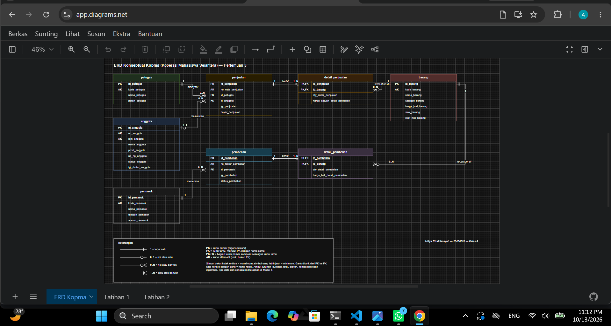
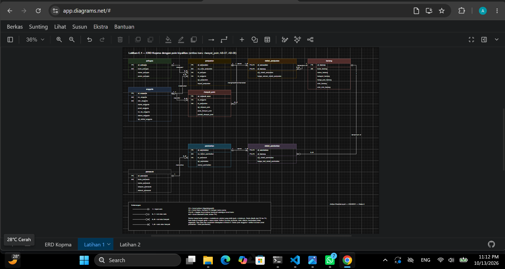
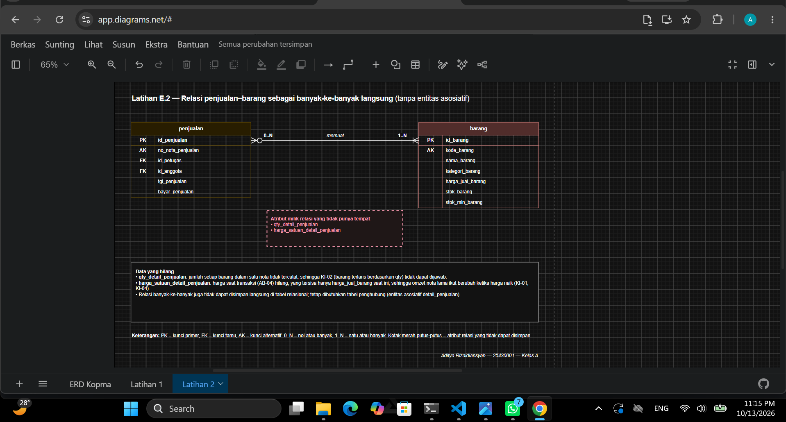
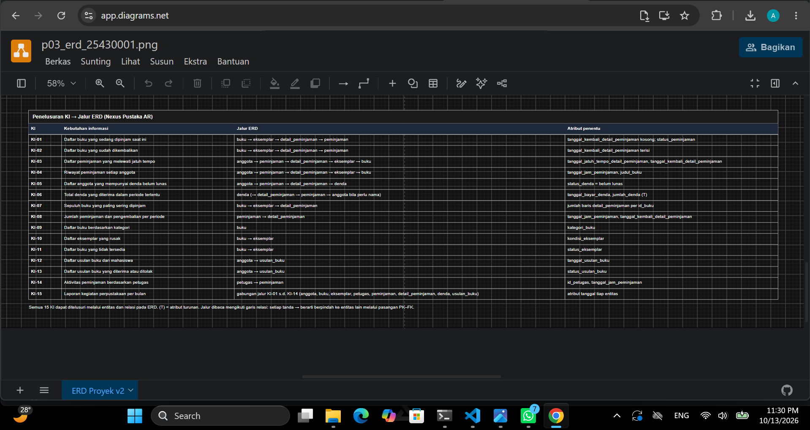
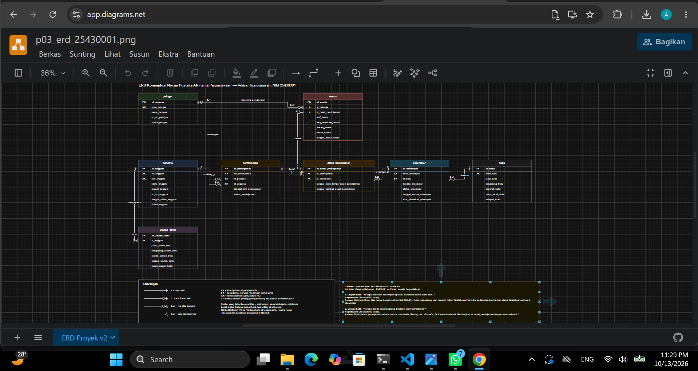
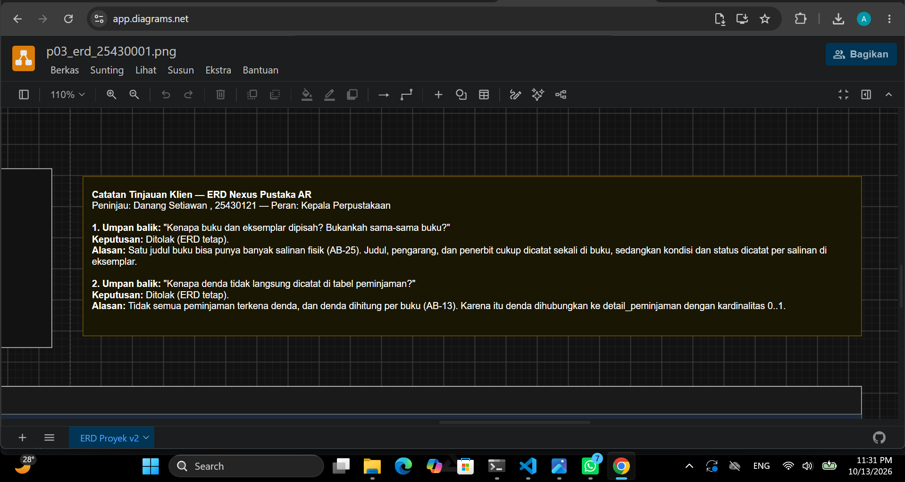
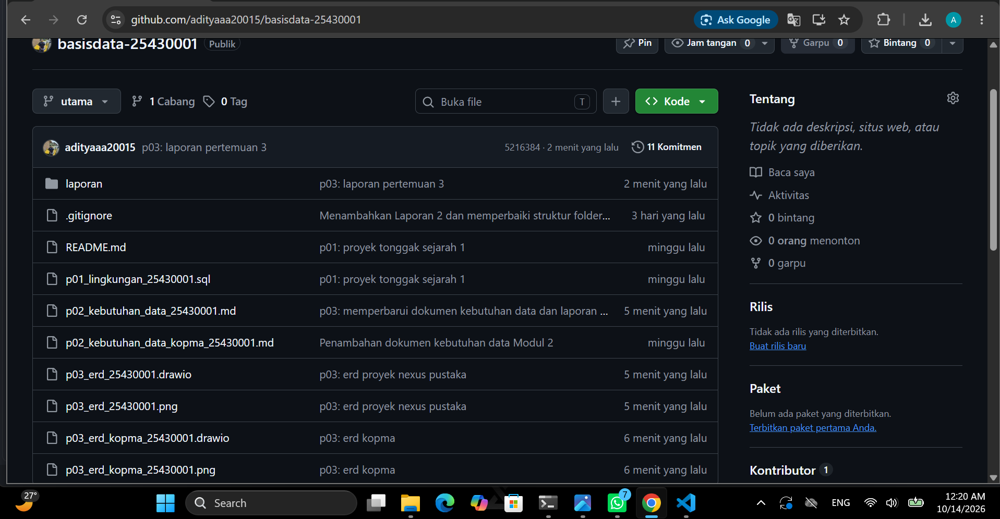

# Laporan Praktikum Basis Data - Pertemuan 03

**Nama:** Aditya Rizaldiansyah
**NIM:** 25430001
**Kelas:** A
**Pertemuan:** 3 — Pemodelan Data dengan Entity-Relationship Diagram
**Tanggal:** 10 Oktober 2026
**Dosen:** Dedi Irawan S.kom,M.ti

## 1. Tujuan Praktikum

1. Menentukan entitas, atribut, kunci primer, kunci alternatif, dan atribut turunan dari dokumen kebutuhan data.
2. Menentukan relasi antarentitas beserta kardinalitas dan partisipasinya berdasarkan aturan bisnis.
3. Mengganti relasi banyak-ke-banyak dengan entitas asosiatif.
4. Menggambar ERD notasi Crow's Foot di draw.io dan memeriksa bahwa semua kebutuhan informasi (KI) dapat ditelusuri.

## 2. Ringkasan Dasar Teori

ERD adalah hasil tahap desain konseptual. ERD menggambarkan data sebagai **entitas** (hal yang dicatat), **atribut** (sifat entitas), dan **relasi** (hubungan antarentitas yang dibaca sebagai kata kerja). Pada tahap ini belum ditentukan tipe data atau DBMS; yang dipastikan adalah semua kebutuhan data sudah tercakup.

Setiap entitas punya **atribut kunci** yang membedakan setiap anggotanya. Atribut lain yang juga unik dicatat sebagai **kunci alternatif**. **Atribut turunan** adalah nilai yang bisa dihitung dari atribut lain, misalnya total nota.

**Kardinalitas** menjawab "paling banyak berapa", sedangkan **partisipasi** menjawab "wajib ada atau boleh tidak ada". Notasi Crow's Foot menggabungkan keduanya di ujung garis. Simbol yang dekat dengan kotak entitas menunjukkan maksimum, dan simbol yang lebih jauh menunjukkan minimum. Kardinalitas tidak boleh ditebak, tetapi harus dapat ditelusuri ke aturan bisnis.

**Relasi banyak-ke-banyak** tidak dapat disimpan langsung di tabel relasional, apalagi jika relasinya punya atribut sendiri (misalnya qty dan harga saat transaksi). Relasi seperti ini diganti dengan **entitas asosiatif** yang berhubungan satu-ke-banyak dengan kedua entitas asalnya.

## 3. Hasil Langkah Percobaan

Catatan sumber: dokumen `p02_kebutuhan_data_kopma_25430001.md` milik saya ternyata berisi kasus perpustakaan, bukan Koperasi Mahasiswa Sejahtera. Karena itu, Langkah D pada pertemuan ini mengacu langsung pada tabel Kopma di buku praktikum (Tabel 2.2–2.7). Penjelasannya ada di bagian 7.

### D.1 Kunci dan atribut turunan entitas Kopma

Sumber: Tabel 2.3 (entitas kandidat), Tabel 2.4 (aturan bisnis), Tabel 2.7 (kamus data), dan Gambar 2.5 (nota penjualan).

| Entitas | Atribut | PK | Kunci alternatif | Atribut turunan | Dasar |
|---|---|---|---|---|---|
| anggota | id_anggota, no_anggota, nim_anggota, nama_anggota, prodi_anggota, no_hp_anggota, status_anggota | id_anggota | no_anggota, nim_anggota | - | AB-05; Tabel 2.7 (no_anggota dan nim_anggota unik) |
| barang | id_barang, kode_barang, nama_barang, kategori_barang, harga_jual_barang, stok_barang, stok_min_barang | id_barang | kode_barang | - | Kode alami (Tabel P.3); AB-03, AB-06 |
| penjualan | id_penjualan, no_nota_penjualan, tgl_penjualan, bayar_penjualan, kasir (→ petugas), anggota (→ anggota, boleh kosong) | id_penjualan | no_nota_penjualan | jumlah_penjualan, diskon_penjualan, total_penjualan, kembalian | AB-01, AB-02; Gambar 2.5 |
| detail_penjualan | nota (→ penjualan), barang (→ barang), qty_detail_penjualan, harga_satuan_detail_penjualan | komposit: nota + barang | - | subtotal_detail_penjualan | AB-01, AB-04 |
| petugas | id_petugas, kode_petugas, nama_petugas, peran_petugas | id_petugas | kode_petugas | - | Kode alami (Tabel P.3); wawancara |
| pemasok | id_pemasok, kode_pemasok, nama_pemasok, telepon_pemasok, alamat_pemasok | id_pemasok | kode_pemasok | - | Kode alami (Tabel P.3); faktur pemasok |

Catatan:

- Atribut turunan tidak dimasukkan ke daftar atribut entitas. Keputusan menyimpan atau menghitungnya ditunda ke Pertemuan 4.
- `harga_satuan_detail_penjualan` bukan atribut turunan. Walaupun nilainya mula-mula disalin dari `harga_jual_barang`, AB-04 mewajibkan nilai itu tetap meskipun harga barang kemudian naik.

### D.2 Memecah "Pembelian dan detailnya"

Entitas kandidat "Pembelian dan detailnya" (nomor faktur, tanggal, pemasok, barang, qty, harga beli) dipecah dengan pola yang sama seperti penjualan. Data yang muncul sekali per faktur dipisahkan dari data yang berulang per baris barang.

| Entitas | Atribut | PK | Kunci alternatif | Atribut turunan |
|---|---|---|---|---|
| pembelian | id_pembelian, no_faktur_pembelian, tgl_pembelian, pemasok (→ pemasok) | id_pembelian | no_faktur_pembelian | total_pembelian |
| detail_pembelian | pembelian (→ pembelian), barang (→ barang), qty_detail_pembelian, harga_beli_detail_pembelian | komposit: pembelian + barang | - | subtotal_detail_pembelian |

Dengan begitu, Kopma memiliki **delapan entitas**: petugas, anggota, pemasok, barang, penjualan, detail_penjualan, pembelian, dan detail_pembelian.

### D.3–D.4 Relasi dan kardinalitas Kopma

| No | Relasi | Sisi kiri | Sisi kanan | Dasar | Alasan |
|---|---|---|---|---|---|
| R1 | petugas melayani penjualan | tepat satu petugas (1) | nol atau banyak penjualan (0..N) | wawancara kasir | Setiap nota pasti dilayani satu kasir, sedangkan petugas yang belum pernah melayani (misalnya petugas gudang) tetap tercatat. |
| R2 | anggota melakukan penjualan | nol atau satu anggota (0..1) | nol atau banyak penjualan (0..N) | AB-02 | Penjualan boleh tanpa anggota (pembeli umum), sehingga sisi anggota bernilai nol atau satu. |
| R3 | penjualan berisi detail_penjualan | tepat satu penjualan (1) | satu atau banyak detail (1..N) | AB-01 | Setiap nota minimal memiliki satu baris barang, dan setiap baris detail milik tepat satu nota. |
| R4 | barang tercantum di detail_penjualan | tepat satu barang (1) | nol atau banyak detail (0..N) | AB-04 | Setiap baris detail merujuk satu barang beserta harga saat itu; barang baru boleh belum pernah terjual. |
| R5 | pemasok menerima pembelian | tepat satu pemasok (1) | nol atau banyak pembelian (0..N) | AB-06 | Setiap pesanan pembelian ditujukan ke satu pemasok; pemasok baru boleh belum pernah menerima pesanan. |
| R6 | pembelian berisi detail_pembelian | tepat satu pembelian (1) | satu atau banyak detail (1..N) | faktur pemasok | Faktur selalu memuat minimal satu baris barang. |
| R7 | barang tercantum di detail_pembelian | tepat satu barang (1) | nol atau banyak detail (0..N) | faktur pemasok | Tidak tercantum di Tabel 3.2, tetapi diperlukan agar detail_pembelian tahu barang apa yang dibeli. Barang boleh belum pernah dibeli ulang. |

Kesimpulan relasi banyak-ke-banyak: hubungan **penjualan–barang** dan **pembelian–barang** sebenarnya banyak-ke-banyak, dan relasinya punya atribut sendiri (qty dan harga). Karena itu keduanya dipecah menjadi entitas asosiatif **detail_penjualan** dan **detail_pembelian**.

### D.5–D.6 ERD Kopma di draw.io

ERD delapan entitas digambar di draw.io (pustaka *Entity Relation*) sesuai Tabel 3.3: nama tabel huruf kecil tunggal dengan satu warna per entitas, semua atribut tercantum dengan label PK, FK, dan PK,FK, kedua ujung garis memakai simbol Crow's Foot dan label angka, garis ditarik dari PK ke FK, serta kotak keterangan di bagian bawah. Tipe data dan constraint belum dicantumkan karena baru ditetapkan di Modul 5.

Berkas: `p03_erd_kopma_25430001.drawio` dan `p03_erd_kopma_25430001.png`

*Gambar 3.1 ERD Kopma di draw.io dengan label kardinalitas terbaca.*

### D.7–D.8 Validasi ERD Kopma terhadap KI

| KI | Kebutuhan informasi | Jalur ERD | Atribut kunci | Status |
|---|---|---|---|---|
| KI-01 | Omzet dan jumlah nota per hari dan per bulan | penjualan → detail_penjualan (dan penjualan → anggota untuk diskon) | tgl_penjualan, qty_detail_penjualan, harga_satuan_detail_penjualan, status_anggota | Tertelusuri |
| KI-02 | Lima barang terlaris per bulan berdasarkan qty | barang → detail_penjualan → penjualan | qty_detail_penjualan, tgl_penjualan | Tertelusuri (kata "per bulan" membuat jalur harus sampai ke penjualan) |
| KI-03 | Barang dengan stok di bawah batas minimum | barang | stok_barang, stok_min_barang | Tertelusuri |
| KI-04 | Sepuluh anggota dengan belanja terbesar per bulan | anggota → penjualan → detail_penjualan | tgl_penjualan, qty_detail_penjualan, harga_satuan_detail_penjualan | Tertelusuri |

Semua KI Kopma dapat ditelusuri, sehingga tidak ada perbaikan ERD pada tahap D.8.

### D.10 Commit

Pekerjaan Kopma dicommit dengan pesan `p03: erd kopma` (hash dicantumkan di bagian 10).

## 4. Jawaban Titik Analisis

**Titik Analisis 1**

*Pertanyaan: no_anggota dan nim_anggota sama-sama unik. Mengapa buku tetap memakai id_anggota sebagai kunci primer? Sebutkan satu risiko jika NIM dijadikan kunci primer.*

id_anggota adalah kunci pengganti (surrogate key) yang dibuat oleh sistem dan tidak memiliki makna bisnis, sehingga nilainya tidak pernah perlu diubah. Sebaliknya, no_anggota dan NIM berasal dari dunia nyata: formatnya bisa berganti dan nilainya bisa salah ketik saat pendaftaran. Karena itu keduanya tetap dicatat sebagai kunci alternatif yang unik untuk pencarian (AB-05), tetapi tidak dijadikan kunci primer.

Risiko jika NIM dijadikan kunci primer: NIM akan tersalin sebagai kunci tamu di setiap baris penjualan anggota tersebut. Jika NIM salah input dan perlu dikoreksi, semua baris penjualan yang merujuknya ikut harus diubah. Selain itu, NIM adalah data pribadi, sehingga menjadikannya kunci berarti menyebarkan data pribadi ke tabel-tabel transaksi.

**Titik Analisis 2**

*Pertanyaan: Sisi penjualan terhadap detail_penjualan bernilai satu atau banyak, bukan nol atau banyak. Aturan bisnis mana yang memaksanya? Apakah aturan "minimal satu" ini dapat dijaga oleh struktur tabel saja?*

Aturan yang memaksanya adalah **AB-01**: setiap nota memiliki nomor unik dan minimal satu baris barang. Nota tanpa barang tidak bermakna, sehingga sisi detail bernilai 1..N.

Aturan ini **tidak dapat dijaga oleh struktur tabel saja**. Kunci tamu di detail_penjualan hanya menjamin arah sebaliknya, yaitu setiap baris detail pasti punya nota induk. Tidak ada constraint yang mencegah satu baris penjualan disimpan tanpa satu pun baris detail, karena baris penjualan harus dibuat lebih dulu sebelum detailnya bisa dimasukkan. Aturan ini perlu dijaga dengan transaksi: nota dan seluruh detailnya disimpan sekaligus, atau dibatalkan semuanya (dibahas di Modul 14).

**Titik Analisis 3**

*Pertanyaan: Ketua ingin mengetahui "petugas gudang mana yang menerima barang dari pemasok". Apakah ERD saat ini dapat menjawabnya? Jika belum, relasi apa yang perlu ditambahkan, dan apakah keputusan itu perlu dicatat sebagai aturan bisnis baru?*

**Belum dapat.** Pada ERD saat ini, petugas hanya berelasi dengan penjualan (R1). Entitas pembelian hanya terhubung ke pemasok dan detail_pembelian, sehingga tidak ada jalur dari pembelian ke petugas.

Relasi yang perlu ditambahkan adalah **petugas menerima pembelian**, dengan kunci tamu ke petugas di entitas pembelian. Kardinalitasnya:

- sisi petugas **nol atau satu (0..1)**, karena pesanan dibuat dulu (PB-03) dan petugas penerima baru diketahui saat barang datang (PB-04);
- sisi pembelian **nol atau banyak (0..N)**, karena satu petugas gudang dapat menerima banyak pembelian.

**Ya, perlu dicatat sebagai aturan bisnis baru.** Kardinalitas tidak boleh ditebak dan harus dapat ditelusuri ke aturan bisnis, sedangkan AB-01 sampai AB-06 tidak ada yang mengatur siapa penerima barang. Usulan aturan: *"Setiap penerimaan barang dari pemasok dicatat beserta petugas gudang yang menerimanya."*

## 5. Hasil Latihan dan Modifikasi

### Latihan 1: Poin loyalitas

Kebutuhan dari latihan Pertemuan 2: setiap kelipatan Rp10.000 belanja anggota bernilai 1 poin, dan 50 poin dapat ditukar dengan potongan Rp5.000. Aturan bisnis yang dipakai:

- **AB-07:** setiap kelipatan Rp10.000 belanja anggota menghasilkan 1 poin.
- **AB-08:** 50 poin dapat ditukar dengan potongan Rp5.000.

**Keputusan: poin memerlukan entitas riwayat poin, tidak cukup menjadi atribut anggota.**

Alasan:

1. Jika poin hanya disimpan sebagai atribut `poin_anggota`, sistem hanya tahu saldo akhir. Sistem tidak tahu kapan poin diperoleh, dari nota mana, dan kapan ditukar, sehingga saldo tidak bisa diperiksa ulang jika ada keluhan anggota.
2. Penukaran poin adalah kejadian tersendiri yang punya tanggal dan nota tempat potongan dipakai. Kejadian seperti ini harus dicatat sebagai entitas.
3. Aturan konversi poin bisa berubah di kemudian hari. Sama seperti AB-04 untuk harga, poin yang sudah diperoleh perlu dikunci per transaksi agar riwayat lama tidak berubah.
4. Saldo poin cukup menjadi **atribut turunan**, yaitu jumlah perolehan dikurangi jumlah penukaran.

Rancangan tambahan:

| Entitas | Atribut | PK | Atribut turunan |
|---|---|---|---|
| riwayat_poin | id_riwayat_poin, anggota (→ anggota), penjualan (→ penjualan), tgl_riwayat_poin, jenis_riwayat_poin (perolehan/penukaran), jumlah_riwayat_poin | id_riwayat_poin | saldo poin anggota |

| Relasi | Sisi kiri | Sisi kanan | Dasar |
|---|---|---|---|
| anggota memiliki riwayat_poin | tepat satu anggota (1) | nol atau banyak riwayat (0..N) | AB-07 |
| penjualan menghasilkan/memakai riwayat_poin | tepat satu penjualan (1) | nol atau banyak riwayat (0..N) | AB-07, AB-08 |

*Gambar 3.2 Halaman Latihan 1: ERD Kopma dengan tambahan entitas riwayat_poin.*

### Latihan 2: Penjualan–barang sebagai banyak-ke-banyak langsung

Relasi digambar ulang menjadi **penjualan (0..N) — memuat — (1..N) barang**, tanpa detail_penjualan.

*Gambar 3.3 Halaman Latihan 2: relasi penjualan–barang tanpa entitas asosiatif.*

Data yang hilang:

1. **qty_detail_penjualan.** Tidak ada tempat untuk menyimpan berapa banyak barang tertentu yang dibeli di nota tertentu, karena qty bukan milik penjualan saja dan bukan milik barang saja, melainkan milik pasangan nota–barang.
2. **harga_satuan_detail_penjualan.** Harga saat transaksi (AB-04) tidak dapat disimpan. Satu-satunya harga yang tersedia adalah harga_jual_barang saat ini, sehingga omzet nota lama ikut berubah setiap kali harga naik.
3. Akibatnya **KI-01** (omzet), **KI-02** (barang terlaris berdasarkan qty), dan **KI-04** (belanja anggota) tidak dapat dihitung dengan benar.
4. Secara struktur, relasi banyak-ke-banyak juga tidak dapat disimpan langsung di tabel relasional. Pada akhirnya tetap dibutuhkan tabel penghubung, yaitu entitas asosiatif.

## 6. Tugas Mandiri: Milestone Proyek 03

Proyek: **Nexus Pustaka AR** (tema Perpustakaan, kode `perpus`, dua digit terakhir NIM 01).
Sumber: `p02_kebutuhan_data_25430001.md`.

### 6.1 Entitas, kunci, dan atribut turunan

| Entitas | PK | Kunci alternatif | Atribut turunan | Jenis |
|---|---|---|---|---|
| anggota | id_anggota | no_anggota (AB-02), nim_anggota (AB-03) | - | Master |
| buku | id_buku | kode_buku (AB-19) | - | Master |
| eksemplar | id_eksemplar | kode_eksemplar (AB-20) | - | Master |
| petugas | id_petugas | kode_petugas | - | Master |
| peminjaman | id_peminjaman | no_peminjaman | - | Kepala transaksi |
| detail_peminjaman | id_detail_peminjaman | - | - | Entitas asosiatif (peminjaman–eksemplar) |
| denda | id_denda | - | hari_terlambat_denda, jumlah_denda (AB-15) | Transaksi |
| usulan_buku | id_usulan_buku | - | - | Transaksi |

**Entitas asosiatif:** hubungan peminjaman–eksemplar adalah banyak-ke-banyak, karena satu peminjaman memuat banyak eksemplar dan satu eksemplar dipinjam berkali-kali sepanjang waktu. Hubungan ini dipecah menjadi **detail_peminjaman** dengan atribut sendiri: `tanggal_jatuh_tempo_detail_peminjaman` dan `tanggal_kembali_detail_peminjaman`. Syarat minimal satu entitas asosiatif dengan atribut sendiri terpenuhi.

**Atribut turunan:** `hari_terlambat_denda` dan `jumlah_denda` dapat dihitung dari tanggal dan tarif (AB-15), sehingga di ERD ditandai T. Keputusan menyimpan atau menghitungnya ditunda ke Pertemuan 4. `tarif_denda` tetap disimpan karena AB-14 mengunci tarif per transaksi.

### 6.2 Tabel relasi dan kardinalitas proyek

| No | Relasi | Sisi kiri | Sisi kanan | Dasar | Alasan |
|---|---|---|---|---|---|
| P1 | anggota melakukan peminjaman | tepat satu anggota (1) | nol atau banyak peminjaman (0..N) | AB-01, AB-09 | Setiap peminjaman wajib mencatat anggota. Anggota baru boleh belum pernah meminjam. |
| P2 | anggota mengajukan usulan_buku | tepat satu anggota (1) | nol atau banyak usulan (0..N) | AB-18 | Setiap usulan wajib memiliki anggota pengusul. |
| P3 | petugas menangani peminjaman | tepat satu petugas (1) | nol atau banyak peminjaman (0..N) | AB-09, AB-22 | Setiap transaksi wajib mencatat petugas yang menangani. |
| P4 | petugas menerima pembayaran denda | nol atau satu petugas (0..1) | nol atau banyak denda (0..N) | AB-16, AB-17, AB-22 | Denda yang belum lunas tetap dicatat (AB-17) tetapi belum punya petugas penerima, sehingga sisi petugas boleh kosong. |
| P5 | peminjaman berisi detail_peminjaman | tepat satu peminjaman (1) | satu atau banyak detail (1..N) | AB-05 | Satu transaksi memuat minimal satu dan maksimal 4 buku (P + 2). Batas 4 tidak dapat digambar di ERD dan dicatat untuk Modul 14. |
| P6 | eksemplar tercantum di detail_peminjaman | tepat satu eksemplar (1) | nol atau banyak detail (0..N) | AB-06, AB-08 | Setiap baris detail merujuk satu buku fisik. Eksemplar dipinjam berkali-kali sepanjang waktu, tetapi tidak dalam dua peminjaman aktif sekaligus (aturan waktu, bukan kardinalitas). |
| P7 | buku memiliki eksemplar | tepat satu buku (1) | nol atau banyak eksemplar (0..N) | AB-25 | Satu judul memiliki banyak salinan fisik. Judul boleh tercatat sebelum eksemplarnya tiba (PB-10). |
| P8 | detail_peminjaman dikenai denda | tepat satu detail (1) | nol atau satu denda (0..1) | AB-13, AB-17 | Denda hanya muncul jika buku terlambat dikembalikan; satu buku dalam satu peminjaman paling banyak punya satu denda. |

### 6.3 Pemetaan entitas ke PB dan KI (Pertemuan 2)

| Entitas | Proses bisnis (PB) | Kebutuhan informasi (KI) |
|---|---|---|
| anggota | PB-01, PB-02, PB-05, PB-07, PB-08, PB-09, PB-10, PB-11, PB-12 | KI-03, KI-04, KI-05, KI-12, KI-13, KI-15 |
| buku | PB-03, PB-04, PB-05, PB-09, PB-10, PB-11, PB-12 | KI-01, KI-02, KI-03, KI-04, KI-07, KI-09, KI-10, KI-11, KI-15 |
| eksemplar | PB-03, PB-04, PB-05, PB-06, PB-07, PB-11, PB-12 | KI-01, KI-02, KI-03, KI-04, KI-07, KI-10, KI-11 |
| petugas | PB-01 s.d. PB-12 (R) | KI-14, KI-15 |
| peminjaman | PB-05, PB-06, PB-07, PB-08, PB-11, PB-12 | KI-01, KI-02, KI-03, KI-04, KI-05, KI-08, KI-14, KI-15 |
| detail_peminjaman | PB-05, PB-06, PB-07, PB-08, PB-11, PB-12 | KI-01, KI-02, KI-03, KI-04, KI-05, KI-07, KI-08, KI-15 |
| denda | PB-05, PB-06, PB-07, PB-08, PB-11, PB-12 | KI-05, KI-06, KI-15 |
| usulan_buku | PB-09, PB-10, PB-12 | KI-12, KI-13, KI-15 |

Setiap entitas didukung minimal satu PB dan satu KI, sehingga tidak ada entitas yang tidak dibutuhkan.

### 6.4 Penelusuran KI ke jalur ERD proyek

| KI | Kebutuhan informasi | Jalur ERD | Atribut penentu | Status |
|---|---|---|---|---|
| KI-01 | Daftar buku yang sedang dipinjam | buku → eksemplar → detail_peminjaman → peminjaman | tanggal_kembali_detail_peminjaman kosong | Tertelusuri |
| KI-02 | Daftar buku yang sudah dikembalikan | buku → eksemplar → detail_peminjaman → peminjaman | tanggal_kembali_detail_peminjaman terisi | Tertelusuri |
| KI-03 | Peminjaman yang melewati jatuh tempo | anggota → peminjaman → detail_peminjaman → eksemplar → buku | tanggal_jatuh_tempo_detail_peminjaman, tanggal_kembali_detail_peminjaman | Tertelusuri |
| KI-04 | Riwayat peminjaman setiap anggota | anggota → peminjaman → detail_peminjaman → eksemplar → buku | tanggal_jam_peminjaman, judul_buku | Tertelusuri |
| KI-05 | Anggota yang mempunyai denda belum lunas | anggota → peminjaman → detail_peminjaman → denda | status_denda | Tertelusuri |
| KI-06 | Total denda yang diterima per periode | denda | tanggal_bayar_denda, jumlah_denda (turunan) | Tertelusuri |
| KI-07 | Sepuluh buku paling sering dipinjam | buku → eksemplar → detail_peminjaman | jumlah baris detail per buku | Tertelusuri |
| KI-08 | Jumlah peminjaman dan pengembalian per periode | peminjaman → detail_peminjaman | tanggal_jam_peminjaman, tanggal_kembali_detail_peminjaman | Tertelusuri |
| KI-09 | Daftar buku berdasarkan kategori | buku | kategori_buku | Tertelusuri |
| KI-10 | Daftar eksemplar yang rusak | buku → eksemplar | kondisi_eksemplar | Tertelusuri |
| KI-11 | Daftar buku yang tidak tersedia | buku → eksemplar | status_eksemplar | Tertelusuri |
| KI-12 | Daftar usulan buku dari mahasiswa | anggota → usulan_buku | tanggal_usulan_buku | Tertelusuri |
| KI-13 | Usulan buku yang diterima atau ditolak | anggota → usulan_buku | status_usulan_buku | Tertelusuri |
| KI-14 | Aktivitas peminjaman berdasarkan petugas | petugas → peminjaman | id_petugas, tanggal_jam_peminjaman | Tertelusuri |
| KI-15 | Laporan kegiatan perpustakaan per bulan | gabungan jalur KI-01 s.d. KI-14 | atribut tanggal tiap entitas | Tertelusuri |

Seluruh 15 KI dapat ditelusuri melalui ERD. Tabel yang sama juga dicantumkan di bawah diagram pada berkas ERD proyek.

*Gambar 3.4 Tabel penelusuran KI → jalur ERD pada berkas draw.io proyek.*

### 6.5 Keputusan desain

1. Ditambahkan **AB-25**: "Setiap eksemplar merupakan salinan fisik dari tepat satu judul buku; satu judul dapat memiliki banyak eksemplar." Aturan ini menjadi dasar relasi P7.
2. Relasi "petugas memproses usulan buku" dari bagian 12 dokumen Modul 2 **dihapus**, karena tidak memiliki atribut maupun aturan bisnis dan tidak dibutuhkan oleh KI mana pun.
3. Atribut `jumlah_perpanjangan` **dihapus**, karena tidak memiliki aturan bisnis maupun proses bisnis yang memakainya.
4. Nama kolom disesuaikan dengan pola `<atribut>_<nama_tabel>` (Tabel P.3), misalnya `nim_mahasiswa` menjadi `nim_anggota`, `tanggal_daftar` menjadi `tanggal_daftar_anggota`, `tahun_terbit` menjadi `tahun_terbit_buku`, dan `id_usulan` menjadi `id_usulan_buku`.
5. Belum ditindaklanjuti: operasi C untuk petugas pada matriks CRUD Modul 2, dan pencatatan petugas penerima pengembalian (isu kualitas 10.9).

### 6.6 ERD proyek

ERD proyek digambar di draw.io dengan standar yang sama (Tabel 3.3): delapan entitas berwarna, semua atribut dari kamus data dengan label PK, FK, AK, dan T (turunan), delapan garis relasi dari PK ke FK dengan simbol Crow's Foot, label angka, dan kata kerja, serta kotak keterangan di bagian bawah.

Berkas: `p03_erd_25430001.drawio` dan `p03_erd_25430001.png`

*Gambar 3.5 ERD konseptual Nexus Pustaka AR di draw.io.*

### 6.7 Catatan tinjauan klien proyek

Tinjauan dilakukan oleh teman sekelas yang berperan sebagai Kepala Perpustakaan Nexus Pustaka AR. Catatan yang sama ditulis di bagian akhir berkas ERD.

| No | Pemberi umpan balik | Umpan balik | Keputusan | Alasan |
|---|---|---|---|---|
| 1 | Danang Setiawan (25430121) | Kenapa buku dan eksemplar dipisah? Bukankah sama-sama buku? | Ditolak (ERD tetap) | Satu judul buku bisa memiliki banyak salinan fisik (AB-25). Judul, pengarang, dan penerbit cukup dicatat sekali di buku, sedangkan kondisi dan status dicatat per salinan di eksemplar. |
| 2 | Danang Setiawan (25430121) | Kenapa denda tidak langsung dicatat di tabel peminjaman? | Ditolak (ERD tetap) | Tidak semua peminjaman terkena denda, dan denda dihitung per buku (AB-13). Karena itu denda dihubungkan ke detail_peminjaman dengan kardinalitas 0..1. |

*Gambar 3.6 Catatan tinjauan klien pada berkas ERD proyek.*

## 7. Pembahasan dan Kendala

1. **Dokumen Kopma Pertemuan 2 tidak sesuai kasus buku.** Saat mempersiapkan Modul 3, saya menemukan bahwa berkas `p02_kebutuhan_data_kopma_25430001.md` berisi kasus perpustakaan, bukan Koperasi Mahasiswa Sejahtera. Akibatnya kode AB dan KI di berkas tersebut tidak cocok dengan Tabel 3.2 dan contoh KI-04 di Modul 3. Penyelesaiannya, Langkah D pertemuan ini mengacu langsung pada Tabel 2.2–2.7 buku.
2. **Relasi barang–detail_pembelian tidak ada di Tabel 3.2.** Tanpa relasi ini, detail_pembelian tidak tahu barang apa yang dibeli. Relasi ini saya tambahkan sebagai R7 dengan pola yang sama seperti detail_penjualan.
3. **Relasi proyek tanpa kode AB.** Saat menyusun tabel relasi proyek, saya menemukan relasi buku–eksemplar belum punya aturan bisnis, dan relasi petugas–usulan tidak punya atribut maupun aturan bisnis. Penyelesaiannya, saya menambahkan AB-25 dan menghapus relasi petugas–usulan (bagian 6.5).
4. **Garis relasi bersilangan.** Pada tata letak awal ERD proyek, garis *berisi* (peminjaman–detail_peminjaman) dan *dikenai* (detail_peminjaman–denda) saling bersilangan. Penyelesaiannya, denda dipindah ke atas detail_peminjaman dan urutan baris kunci tamu disesuaikan, sehingga tidak ada lagi garis yang bersilangan.

## 8. Kesimpulan

ERD membantu memastikan semua kebutuhan data sudah tercakup sebelum masuk ke desain tabel. Kardinalitas setiap relasi harus ditentukan dari aturan bisnis, bukan ditebak. Relasi banyak-ke-banyak yang punya atribut sendiri harus diganti dengan entitas asosiatif, seperti detail_penjualan pada Kopma dan detail_peminjaman pada proyek saya. Validasi KI membuktikan ERD benar-benar dapat menjawab kebutuhan informasi pengguna.

## 9. Pernyataan Penggunaan AI

Saya menggunakan Claude (Anthropic) untuk membantu menyusun draf laporan ini, meliputi tabel D.1–D.4, D.7, jawaban Titik Analisis 1–3, Latihan 1–2, serta tabel relasi, pemetaan entitas, dan penelusuran KI proyek. AI juga dipakai untuk memeriksa kelengkapan dokumen kebutuhan data Modul 2 dan membuat berkas awal ERD proyek di draw.io, yang kemudian saya periksa dan sesuaikan. Butir tinjauan klien proyek disusun dengan bantuan AI, lalu ditinjau dan disetujui oleh Danang Setiawan. Seluruh isi telah saya periksa, dan saya bertanggung jawab atas keputusan desain di dalamnya.

## 10. Bukti Git

- Repositori: https://github.com/adityaaa20015/basisdata-25430001
- Commit Kopma: `[hash]` — `p03: erd kopma`
- Commit proyek: `[hash]` — `p03: erd proyek nexus pustaka`
- Commit laporan: `p03: laporan pertemuan 3` (hash dapat dilihat pada riwayat commit di bawah)

## Checklist

### Checklist umum

| | Butir | Keterangan |
|---|---|---|
| ☑ | Identitas | Nama, NIM, kelas, pertemuan, tanggal, asisten/dosen |
| ☑ | Tujuan | Ditulis ulang, maksimal 5 baris |
| ☑ | Ringkasan teori | Maksimal setengah halaman |
| ☑ | Langkah percobaan (D) | Tangkapan layar langkah kunci dengan keterangan |
| ☑ | Titik Analisis | Titik Analisis 1–3 dijawab dengan alasan |
| ☑ | Latihan (E) | Hasil latihan beserta bukti |
| ☑ | Tugas Mandiri (F) | Berkas, bukti, dan penjelasan keputusan desain |
| ☑ | Pembahasan dan kendala | Kendala dan cara mengatasinya |
| ☑ | Kesimpulan | 2–4 kalimat |
| ☑ | Pernyataan Penggunaan AI | Alat, kegunaan, dan bagian yang dibantu |
| ☑ | Bukti Git | Tautan repositori dan hash commit `p03: ...` |
| ☑ | Keaslian | Tangkapan layar memperlihatkan jam sistem dan nama berkas ber-NIM |

### Checklist khusus Pertemuan 3

| | Jenis | Yang harus ada |
|---|---|---|
| ☑ | Berkas wajib | p03_erd_kopma_25430001 dan p03_erd_25430001 (gambar + berkas sumber diagram) |
| ☑ | Bukti tangkapan layar | ERD di draw.io dengan kardinalitas terbaca; catatan tinjauan klien |
| ☑ | Analisis wajib | Pemetaan setiap entitas ke PB/KI dari Pertemuan 2; alasan kardinalitas relasi utama |