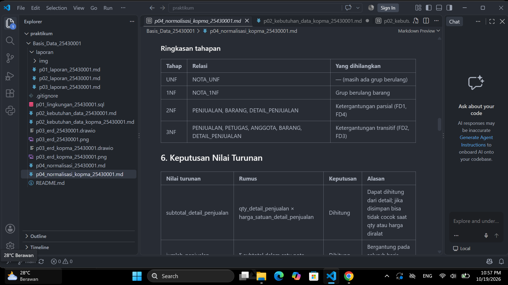
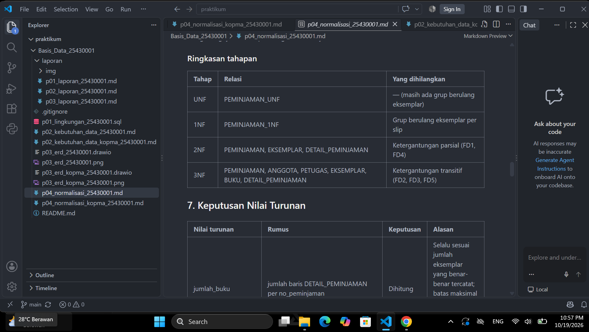
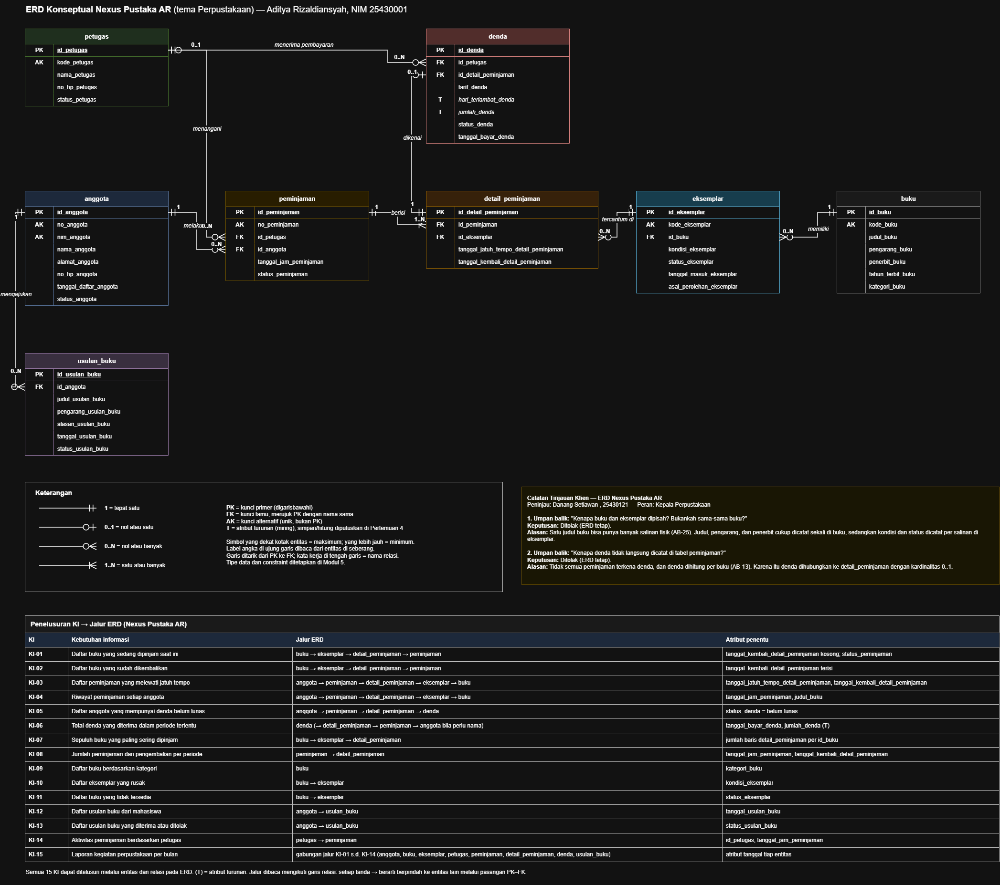
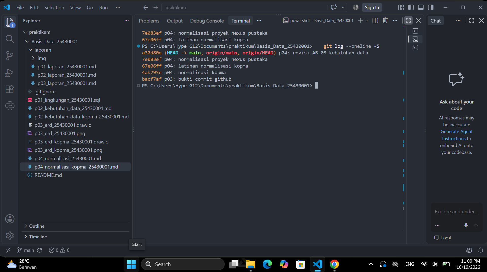

# Laporan Praktikum Basis Data - Pertemuan 04

**Nama:** Aditya Rizaldiansyah
**NIM:** 25430001
**Kelas:** A
**Pertemuan:** 4 — Normalisasi dan Skema Relasional
**Tanggal:** 19 Oktober 2026
**Dosen:** Dedi Irawan S.kom,M.ti

## 1. Tujuan Praktikum

1. Mengenali anomali ubah, sisip, dan hapus pada data yang belum dinormalisasi.
2. Menurunkan dependensi fungsional dari aturan bisnis, bukan dari contoh data.
3. Menormalisasi relasi dari UNF sampai 3NF, lalu memeriksa BCNF.
4. Memutuskan nilai turunan disimpan atau dihitung, lalu menuliskan skema relasional akhir.

## 2. Ringkasan Dasar Teori

Data yang ditulis berulang dalam satu tabel besar menimbulkan tiga anomali: **anomali ubah** (satu fakta ada di banyak baris sehingga bisa berbeda-beda), **anomali sisip** (fakta tidak bisa dicatat sebelum ada fakta lain), dan **anomali hapus** (menghapus satu fakta ikut menghapus fakta lain).

Alat untuk menemukan penyebabnya adalah **dependensi fungsional** (A → B): satu nilai A selalu menentukan tepat satu nilai B. Dependensi ini diambil dari aturan bisnis. Contoh data hanya bisa membantah dependensi, tidak bisa membuktikannya.

Normalisasi berjalan bertahap. **1NF** menghapus grup berulang. **2NF** menghapus ketergantungan pada sebagian kunci komposit. **3NF** menghapus rantai A → B → C di dalam satu tabel. **BCNF** memastikan setiap penentu adalah kunci kandidat. Kunci pengganti `id_*` tidak menyelesaikan normalisasi, jadi pemeriksaan tetap memakai kunci alami.

## 3. Hasil Langkah Percobaan

Langkah percobaan dikerjakan pada kasus Kopma dan disimpan di `p04_normalisasi_kopma_25430001.md`.

1. **UNF → 1NF.** Grup berulang barang pada nota dipecah menjadi satu baris per barang. Kunci menjadi komposit `(no_nota_penjualan, kode_barang)`.
2. **Dependensi fungsional.** FD1–FD6 diturunkan dari aturan bisnis. FD6 (`subtotal_detail_penjualan`) adalah nilai turunan.
3. **2NF.** Atribut yang hanya bergantung pada `no_nota_penjualan` (FD1) dan pada `kode_barang` (FD4) dipisah menjadi `PENJUALAN` dan `BARANG`. Sisanya menjadi `DETAIL_PENJUALAN`.
4. **3NF.** Rantai `no_nota_penjualan → kode_petugas → nama_petugas` dan `no_nota_penjualan → no_anggota → nama_anggota` diputus dengan memisahkan `PETUGAS` dan `ANGGOTA`.
5. **Nilai turunan.** `subtotal_detail_penjualan`, `jumlah_penjualan`, dan `total_penjualan` dihitung, tidak disimpan.
6. **Skema kanonik dan BCNF.** Hasil dicocokkan dengan Tabel 4.2 (kunci pengganti `id_*`, kode alami sebagai kunci unik). Setiap tabel diperiksa BCNF dan tidak ditemukan penentu yang bukan kunci kandidat.



*Gambar 1. Ringkasan tahapan UNF → 1NF → 2NF → 3NF pada kasus Kopma.*

## 4. Jawaban Titik Analisis

**Titik Analisis 1**

`harga_satuan_detail_penjualan` adalah harga **saat barang itu terjual pada nota tertentu**, bukan harga barang saat ini. Harga jual barang bisa berubah, sehingga barang yang sama bisa terjual dengan harga berbeda di nota yang berbeda. Karena itu harga ini ditentukan oleh pasangan `(no_nota_penjualan, kode_barang)`, bukan oleh `kode_barang` saja.

Jika harga dipindah ke tabel `barang`, hanya ada satu harga untuk setiap barang, yaitu harga terbaru. Laporan omzet tahun lalu akan ikut dihitung ulang dengan harga sekarang, sehingga hasilnya salah. Contohnya, pulpen yang dulu terjual Rp4.000 akan terhitung Rp5.000 setelah harganya naik.

**Titik Analisis 2**

Kedua keputusan memakai prinsip yang sama: simpan data yang tidak boleh berubah, hitung data yang masih bisa berubah. Tabel penjualan adalah **data operasional**. Detail nota masih bisa dikoreksi, sehingga total lebih aman dihitung dari detail agar selalu cocok. Tabel arsip adalah **potret historis** yang sudah ditutup dan tidak boleh berubah lagi. Total di arsip disimpan supaya angkanya tetap sama seperti saat diarsipkan, walaupun aturan atau data lain berubah kemudian.

**Titik Analisis 3**

Informasi "barang ini dipasok oleh siapa" sekarang dicatat melalui transaksi pembelian. Tabel `pembelian` menyimpan `id_pemasok`, dan `detail_pembelian` menyimpan barang apa saja yang dibeli pada pembelian itu.

Keuntungannya:

- Satu barang bisa dipasok oleh lebih dari satu pemasok, dan semuanya tercatat.
- Riwayat pemasok tetap tersimpan walaupun Kopma berganti pemasok.
- Nama pemasok hanya ditulis sekali di tabel `pemasok`, sehingga tidak ada ejaan yang berubah-ubah (anomali ubah).

## 5. Hasil Latihan dan Modifikasi

Latihan disimpan di `p04_normalisasi_kopma_25430001.md` (commit `67e06ff`).

**Latihan 1 — Beberapa nomor telepon pemasok**

Nomor telepon adalah grup berulang bagi pemasok. Jika disimpan sebagai `telepon1`, `telepon2`, atau satu sel berisi daftar, tabel melanggar 1NF. Nomor telepon dipisah menjadi relasi baru:

```text
TELEPON_PEMASOK (id_pemasok*, no_telepon_pemasok)
-- kunci primer: (id_pemasok, no_telepon_pemasok)
-- id_pemasok adalah kunci tamu ke PEMASOK
```

Satu pemasok bisa memiliki banyak baris nomor telepon, dan nomor yang sama tidak tercatat dua kali untuk pemasok yang sama.

**Latihan 2 — `nama_anggota` disimpan di tabel penjualan**

Contoh data yang melanggar 3NF, karena ada rantai `id_penjualan → id_anggota → nama_anggota`:

| id_penjualan | id_anggota | nama_anggota |
|---|---|---|
| 1 | 7 | Sari |
| 2 | 7 | Sari |
| 3 | 7 | Sari |

Kueri ubah yang memperlihatkan anomali ubah:

```sql
UPDATE penjualan
SET nama_anggota = 'Sari Lestari'
WHERE id_penjualan = 1;
```

Setelah kueri dijalankan, anggota yang sama (`id_anggota = 7`) tercatat dengan dua nama: "Sari Lestari" di baris 1 dan "Sari" di baris 2–3. Agar konsisten, semua baris dengan `id_anggota = 7` harus diubah, dan itu berisiko jika lupa memakai `WHERE` yang tepat. Solusinya, nama cukup disimpan sekali di tabel `anggota`.

## 6. Tugas Mandiri: Milestone Proyek 04

Proyek: **Nexus Pustaka AR** (perpustakaan). Berkas: `p04_normalisasi_25430001.md`.

**a. Dokumen sumber (UNF)**

Dokumen sumber adalah **Slip Peminjaman** dari Pertemuan 2. Slip direvisi agar memuat Kode Eksemplar, karena yang dipinjam adalah eksemplar fisik, bukan judul buku.

```text
PEMINJAMAN_UNF (no_peminjaman, tanggal_jam_peminjaman, no_anggota, nama_anggota,
  kode_petugas, nama_petugas, { kode_eksemplar, kode_buku, judul_buku },
  jumlah_buku, tanggal_jatuh_tempo, status_peminjaman, total_denda)
```

**b. Daftar dependensi fungsional**

| FD | Dependensi | Dasar |
|---|---|---|
| FD1 | no_peminjaman → tanggal_jam_peminjaman, no_anggota, kode_petugas, tanggal_jatuh_tempo, status_peminjaman | AB-09, AB-10 |
| FD2 | no_anggota → nama_anggota | AB-02 |
| FD3 | kode_petugas → nama_petugas | AB-22 |
| FD4 | kode_eksemplar → kode_buku | AB-20, AB-25 |
| FD5 | kode_buku → judul_buku | AB-19 |
| FD6 | no_peminjaman → jumlah_buku (turunan) | AB-05 |
| FD7 | no_peminjaman → total_denda (turunan) | AB-13, AB-15 |

**c. Tahapan normalisasi**

- **1NF:** grup berulang eksemplar dipecah. Kunci menjadi `(no_peminjaman, kode_eksemplar)`.
- **2NF:** atribut milik slip (FD1) dan milik eksemplar (FD4, FD5) dipisah dari detail.
- **3NF:** rantai ke `nama_anggota`, `nama_petugas`, dan `judul_buku` diputus menjadi tabel `ANGGOTA`, `PETUGAS`, dan `BUKU`.



*Gambar 2. Ringkasan tahapan UNF → 1NF → 2NF → 3NF pada proyek Nexus Pustaka AR.*

**d. Keputusan nilai turunan**

| Nilai | Keputusan | Alasan |
|---|---|---|
| jumlah_buku | Dihitung | Dapat dihitung dari jumlah baris `detail_peminjaman`, sehingga selalu cocok |
| hari_terlambat_denda | Dihitung | Dihitung dari tanggal jatuh tempo dan tanggal kembali |
| jumlah_denda | Dihitung | Hari terlambat × tarif denda. Berubah dari kamus data Modul 2 yang semula "dihitung dan disimpan" |
| total_denda | Dihitung | Jumlah dari denda per buku. Jika disimpan, bisa tidak cocok saat denda per buku berubah |
| tarif_denda | Disimpan | AB-14: tarif bisa berubah, sehingga tarif yang berlaku saat denda dibuat harus dicatat |

**e. Pemeriksaan BCNF**

Ditemukan satu masalah: pada AB-03 lama, `nim_anggota` belum tentu unik, sehingga penentu `nim_anggota → nama_anggota` bukan kunci kandidat. AB-03 direvisi menjadi: *NIM mahasiswa unik untuk setiap anggota. Mahasiswa yang berhenti lalu kembali aktif cukup diubah status keanggotaannya, bukan didaftarkan ulang.* Setelah revisi, kedelapan tabel memenuhi BCNF.

**f. Perubahan ERD dan aturan bisnis**

| No | Perubahan | Alasan |
|---|---|---|
| 1 | `tanggal_jatuh_tempo_detail_peminjaman` dipindah ke `peminjaman` menjadi `tanggal_jatuh_tempo_peminjaman` | AB-10 dan FD1: satu peminjaman memiliki satu tanggal jatuh tempo. Jika disimpan per buku, timbul anomali ubah |
| 2 | AB-03 direvisi di `p02_kebutuhan_data_25430001.md` | Hasil pemeriksaan BCNF |
| 3 | Kunci unik baru: (`id_peminjaman`, `id_eksemplar`) pada `detail_peminjaman` dan `id_detail_peminjaman` pada `denda` | Dicatat untuk diterapkan sebagai constraint `UNIQUE` pada Pertemuan 5 |



*Gambar 3. ERD proyek setelah revisi, dengan catatan "Perubahan Pertemuan 4".*

## 7. Pembahasan dan Kendala

1. **Dependensi harga disimpulkan dari contoh data.** Awalnya saya mengira `kode_barang` menentukan harga satuan karena contoh harganya sama. Setelah kembali ke aturan bisnis, harga ternyata ditentukan oleh nota dan barang.
2. **Slip peminjaman tidak memuat kode eksemplar.** Akibatnya, eksemplar mana yang dipinjam tidak bisa dibedakan. Dokumen sumber direvisi dengan menambah Kode Eksemplar.
3. **Jatuh tempo berada di tabel yang salah pada ERD.** Masalah ini ditemukan saat menulis FD1. ERD diperbaiki dan perubahannya dicatat di p04 dan di commit, tidak dihapus diam-diam.
4. **NIM anggota belum menjadi kunci kandidat.** Masalah ini ditemukan saat pemeriksaan BCNF, lalu diatasi dengan merevisi AB-03.
5. **Latihan Kopma ditambahkan setelah push.** Diatasi dengan commit tambahan `67e06ff` tanpa mengubah commit sebelumnya.
6. **Revisi AB-03 tidak ikut commit.** Hasil commit menunjukkan 3 berkas, bukan 4, karena `p02_kebutuhan_data_25430001.md` belum tersimpan. Saya memeriksanya dengan `git show --stat HEAD`, lalu menyimpan berkas dan membuat commit tambahan `a30d80e`.

## 8. Kesimpulan

Normalisasi menguji apakah rancangan tabel bebas dari anomali ubah, sisip, dan hapus. Kuncinya adalah dependensi fungsional yang diambil dari aturan bisnis, bukan dari contoh data. Pada proyek Nexus Pustaka AR, normalisasi menemukan dua kesalahan yang tidak terlihat di ERD, yaitu letak jatuh tempo dan aturan NIM anggota. Skema 3NF ini menjadi dasar skrip DDL pada Pertemuan 5.

## 9. Pernyataan Penggunaan AI

Saya menggunakan Claude (Anthropic) sebagai pendamping belajar untuk menjelaskan materi normalisasi langkah demi langkah dan untuk membantu menyusun draf isi `p04_normalisasi_kopma_25430001.md`, `p04_normalisasi_25430001.md`, jawaban Titik Analisis, Latihan, serta laporan ini. AI juga membantu mengubah berkas ERD proyek (memindahkan atribut jatuh tempo dan menambah catatan perubahan). Keputusan desain (revisi slip, letak jatuh tempo, nilai turunan dihitung, dan revisi AB-03) saya ambil sendiri setelah menjawab pertanyaan pemahaman. Seluruh isi telah saya periksa, dan saya bertanggung jawab atasnya.

## 10. Bukti Git

- Repositori: https://github.com/adityaaa20015/basisdata-25430001

| Hash | Pesan commit |
|---|---|
| `4ab293c` | p04: normalisasi kopma |
| `67e06ff` | p04: latihan normalisasi kopma |
| `7e083ef` | p04: normalisasi proyek nexus pustaka |
| `a30d80e` | p04: revisi AB-03 kebutuhan data |



*Gambar 4. Hasil `git log --oneline -5` yang memperlihatkan commit Pertemuan 4.*

## Checklist

### Checklist umum

| | Butir | Yang harus ada |
|---|---|---|
| ☑ | Identitas | Nama, NIM, kelas, pertemuan ke-4, tanggal, nama dosen |
| ☑ | Tujuan | Ditulis ulang dengan bahasa sendiri (maksimal 5 baris) |
| ☑ | Ringkasan teori | Pemahaman sendiri, maksimal setengah halaman |
| ☑ | Langkah percobaan (D) | Tangkapan layar langkah kunci beserta keterangan |
| ☑ | Titik Analisis | Titik Analisis 1–3 dijawab lengkap dengan alasan |
| ☑ | Latihan (E) | Dokumen hasil latihan beserta bukti |
| ☑ | Tugas Mandiri (F) | Berkas, bukti, dan penjelasan keputusan desain |
| ☑ | Pembahasan dan kendala | Kendala yang ditemui dan cara mengatasinya |
| ☑ | Kesimpulan | Dua sampai empat kalimat dengan bahasa sendiri |
| ☑ | Pernyataan Penggunaan AI | Alat, kegunaan, dan bagian yang dibantu |
| ☑ | Bukti Git | Tautan repositori dan hash commit `p04: ...` |
| ☑ | Keaslian | Tangkapan layar memperlihatkan jam sistem dan nama berkas ber-NIM |

### Checklist khusus Pertemuan 4

| | Jenis | Yang harus ada |
|---|---|---|
| ☑ | Berkas wajib | p04_normalisasi_25430001.md (proyek) |
| ☑ | Bukti tangkapan layar | Tabel tahapan UNF → 1NF → 2NF → 3NF |
| ☑ | Analisis wajib | Daftar dependensi fungsional; keputusan menyimpan atau menghitung nilai turunan beserta alasannya |
