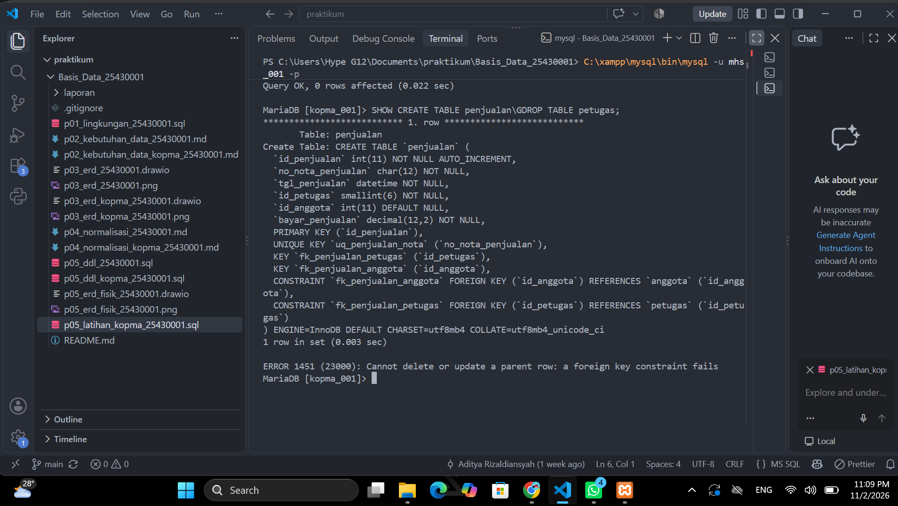
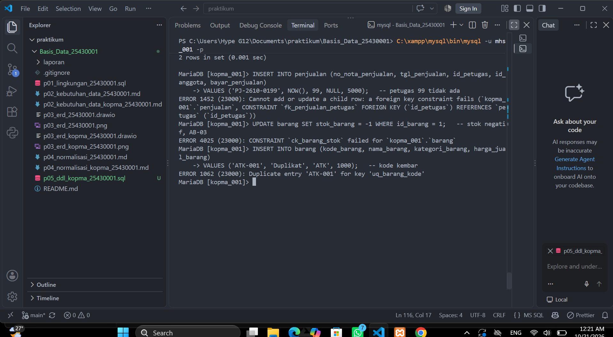
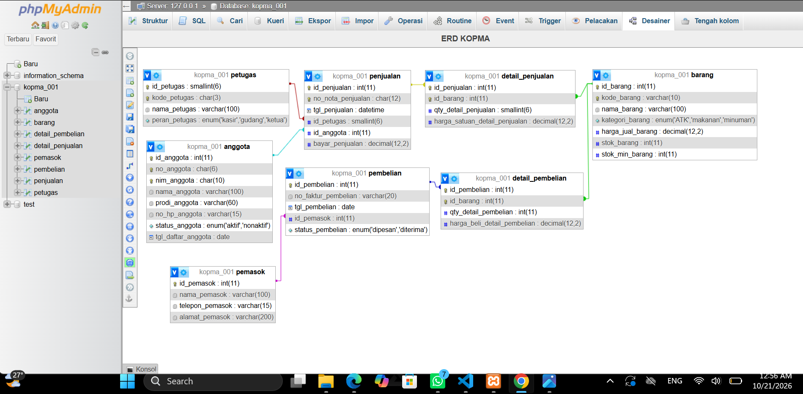
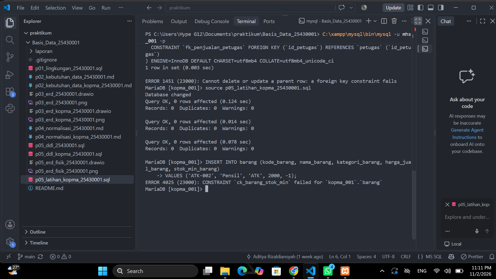
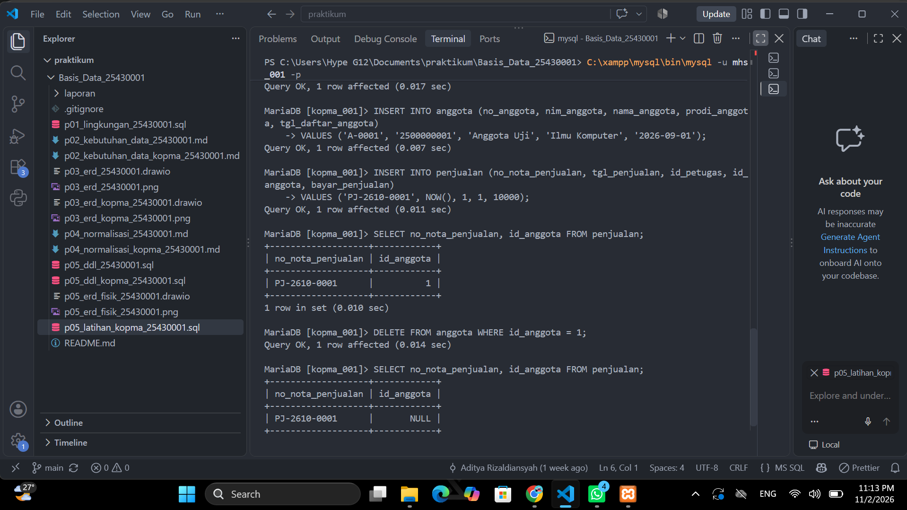
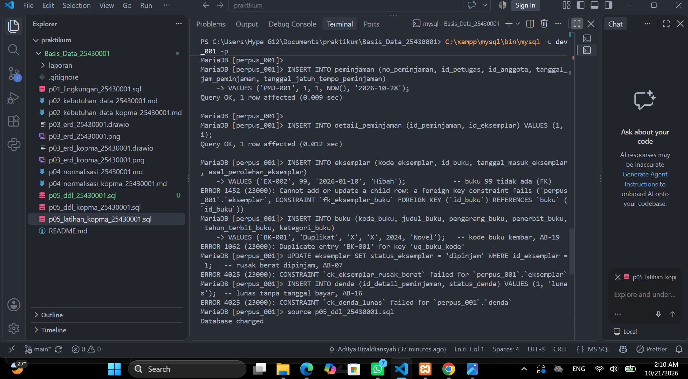
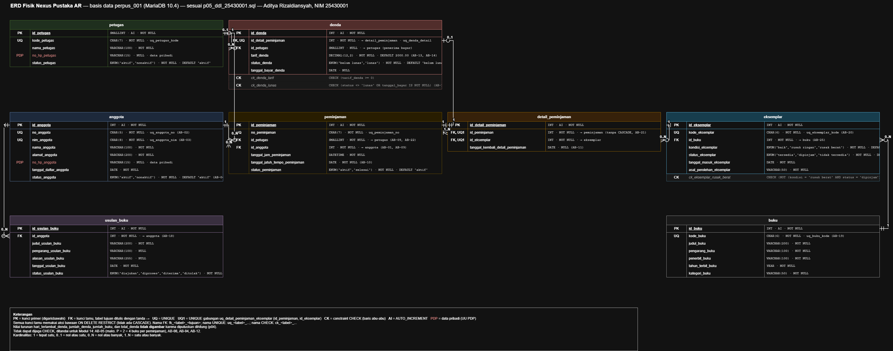
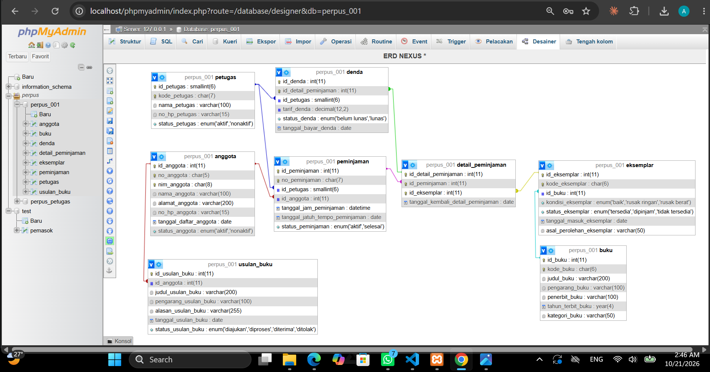

# Laporan Praktikum Basis Data - Pertemuan 05

**Nama:** Aditya Rizaldiansyah
**NIM:** 25430001
**Kelas:** A
**Pertemuan:** 5 — Membangun Struktur dengan DDL dan Constraint
**Tanggal:** 21 Oktober 2026
**Dosen:** Dedi Irawan S.kom,M.ti

---

## 1. Tujuan Praktikum

1. Menerjemahkan skema relasional 3NF menjadi perintah `CREATE TABLE` dengan tipe data yang tepat.
2. Menerapkan constraint PRIMARY KEY, FOREIGN KEY, UNIQUE, NOT NULL, DEFAULT, dan CHECK sebagai wujud aturan bisnis.
3. Mengubah dan menghapus struktur dengan `ALTER TABLE` dan `DROP TABLE` dalam urutan yang benar.
4. Membuktikan bahwa constraint menolak data yang salah, lalu membandingkan desain fisik dengan ERD.

---

## 2. Ringkasan Dasar Teori

**DDL** (*Data Definition Language*) adalah bagian SQL untuk membuat, mengubah, dan menghapus struktur basis data. Memilih tipe data adalah keputusan desain. Tipe yang terlalu besar memboroskan ruang, sedangkan tipe yang terlalu kecil menolak data yang sah. Patokan yang saya pakai: `CHAR` untuk kode berpanjang tetap, `VARCHAR` untuk teks berpanjang bebas, `DECIMAL` untuk uang (karena `FLOAT` menimbulkan galat pembulatan), dan `ENUM` untuk pilihan yang terbatas.

**Constraint** memindahkan aturan bisnis dari "disiplin pengguna" menjadi "jaminan server":

| Constraint | Yang dijaga |
|---|---|
| PRIMARY KEY / UNIQUE | Tidak ada data kembar |
| FOREIGN KEY | Rujukan ke tabel induk benar-benar ada |
| NOT NULL / DEFAULT | Kolom wajib diisi, atau diisi nilai bawaan |
| CHECK | Nilai memenuhi syarat (ditegakkan sejak MariaDB 10.2) |

Batasannya: **CHECK hanya memeriksa satu baris**. Aturan yang melibatkan banyak baris atau beberapa tabel harus dijaga dengan transaksi atau mekanisme lain. Selain itu, tabel induk wajib dibuat sebelum tabel anak dan dihapus sesudahnya.

---

## 3. Hasil Langkah Percobaan

Seluruh langkah Kopma dijalankan dengan akun kerja **`mhs_001`** pada basis data **`kopma_001`** (MariaDB 10.4.32). Skrip disimpan di `p05_ddl_kopma_25430001.sql` dan mengikuti skema kanonik Lampiran C buku.

### 3.1 Membuat tabel (D.1–D.2)

Tabel dibuat dari induk ke anak:

| Jenis | Tabel | Kunci tamu |
|---|---|---|
| Master | `petugas`, `barang`, `anggota`, `pemasok` | — |
| Kepala transaksi | `penjualan`, `pembelian` | → petugas, anggota / → pemasok |
| Detail transaksi | `detail_penjualan`, `detail_pembelian` | → kepala transaksi, barang |

Ringkasan constraint skrip Kopma: **8 PRIMARY KEY**, **7 FOREIGN KEY**, **5 UNIQUE** (`uq_petugas_kode`, `uq_anggota_no`, `uq_anggota_nim`, `uq_barang_kode`, `uq_penjualan_nota`), dan **4 CHECK** (`ck_barang_stok`, `ck_barang_harga`, `ck_detail_qty`, `ck_dbeli_qty`).

Di awal skrip terdapat blok `DROP TABLE IF EXISTS` dengan urutan terbalik (anak dahulu), sehingga skrip **dapat dijalankan ulang** dari kondisi apa pun.



*Gambar 1. `SHOW CREATE TABLE penjualan` memperlihatkan `uq_penjualan_nota`, `fk_penjualan_petugas`, dan `fk_penjualan_anggota`. MariaDB juga otomatis membuat indeks (`KEY`) untuk setiap kolom kunci tamu agar pemeriksaan rujukan berjalan cepat.*

### 3.2 Membuktikan constraint bekerja (D.3)

Setelah data induk uji diisi (dua petugas, dua barang), tiga perintah yang melanggar aturan dijalankan. Ketiganya ditolak server dan data tidak berubah.

| Percobaan | Kode galat | Constraint yang menolak |
|---|---|---|
| Nota dengan `id_petugas = 99` (tidak ada) | 1452 | `fk_penjualan_petugas` |
| `stok_barang = -1` | 4025 | `ck_barang_stok` |
| Kode `ATK-001` dimasukkan dua kali | 1062 | `uq_barang_kode` |



*Gambar 2. Server menolak kunci tamu yang tidak dikenal, stok negatif, dan kode barang kembar.*

### 3.3 Mengubah struktur (D.4)

Kolom tanggal kedaluwarsa ditambahkan tanpa membuat ulang tabel, lalu dibatalkan:

```sql
ALTER TABLE barang ADD COLUMN tgl_kedaluwarsa DATE NULL AFTER stok_min_barang;
-- DESCRIBE barang: 8 kolom; data Pulpen dan Air Mineral tetap ada
ALTER TABLE barang DROP COLUMN tgl_kedaluwarsa;
-- DESCRIBE barang: kembali 7 kolom
```

Kolom baru sengaja dibuat `NULL`. Baris yang sudah ada belum memiliki tanggal kedaluwarsa, sehingga `NOT NULL` tanpa `DEFAULT` akan membuat baris lama tidak memiliki nilai yang sah. Percobaan ini menunjukkan perbedaan penting: `ALTER TABLE` mempertahankan data, sedangkan `DROP` + `CREATE` menghapusnya.

### 3.4 Membandingkan dengan ERD (D.4)



*Gambar 3. phpMyAdmin Designer `kopma_001`: 8 tabel dan 7 garis relasi, sama dengan jumlah FOREIGN KEY di skrip.*

| No | ERD Pertemuan 3 | Desain fisik | Penjelasan |
|---|---|---|---|
| 1 | `pemasok` memiliki `kode_pemasok` (AK) | Kolom tidak ada | Skrip mengikuti Lampiran C buku sebagai acuan tunggal |
| 2 | `no_faktur_pembelian` bertanda AK | Tidak UNIQUE | Nomor faktur berasal dari pemasok; dua pemasok bisa memakai nomor yang sama |
| 3 | Atribut tanpa tipe data | Setiap kolom bertipe dan berconstraint | Tipe ditetapkan pada desain fisik |
| 4 | Kardinalitas penjualan–detail 1..N | Designer hanya menampilkan garis FK | "Minimal satu baris detail" (AB-01) tidak dapat dijaga constraint |

### 3.5 Menguji urutan DROP TABLE (D.4)


*Gambar 4. `DROP TABLE petugas;` ditolak dengan ERROR 1451 karena `petugas` masih dirujuk oleh `penjualan`.*

---

## 4. Jawaban Titik Analisis

### Titik Analisis 1 — CASCADE pada detail, bukan pada barang

Detail nota adalah **bagian dari nota itu sendiri**. Jika nota dibatalkan, rinciannya tidak bermakna lagi, sehingga `fk_detail_penjualan` memakai `ON DELETE CASCADE`.

Sebaliknya, barang adalah **data master yang dirujuk banyak nota lama**. Jika barang boleh dihapus beserta seluruh detailnya, baris penjualan lama ikut hilang. Laporan omzet, barang terlaris, dan belanja anggota pada periode lalu akan berubah angkanya, padahal transaksi itu benar-benar terjadi. Karena itu `fk_detail_barang` memakai aksi bawaan: server menolak penghapusan barang yang pernah terjual (ERROR 1451). Barang yang tidak dijual lagi cukup dihentikan, bukan dihapus.

### Titik Analisis 2 — Pemetaan kode galat ke aturan bisnis

| Kode | Constraint | Aturan bisnis yang dilindungi |
|---|---|---|
| **1452** | `fk_penjualan_petugas` | Setiap nota wajib dilayani petugas yang terdaftar ("jangan sampai ada nota tanpa kasir"). Tabel 2.4 tidak memuat kode AB khusus untuk aturan ini; yang menjaganya adalah relasi petugas–penjualan dengan partisipasi wajib (`id_petugas NOT NULL`) |
| **4025** | `ck_barang_stok` | **AB-03**, bagian "stok barang tidak boleh negatif" |
| **1062** | `uq_barang_kode` | Keunikan kode barang sebagai kunci alami; polanya sama dengan **AB-01** (nomor nota unik) dan **AB-05** (NIM unik) |

**Aturan bisnis Kopma yang belum dapat dijaga constraint:**

| Aturan | Alasan tidak dapat dijaga |
|---|---|
| AB-01: minimal satu baris barang per nota | Menyangkut jumlah baris di tabel lain |
| AB-02: diskon 5% hanya untuk anggota aktif | Harus membaca `status_anggota` di tabel lain saat transaksi |
| AB-03: penjualan ditolak bila qty melebihi stok | Membandingkan dua tabel lalu mengurangi stok; diselesaikan dengan transaksi (Modul 14) |
| AB-06: pesanan dibuat bila stok di bawah minimum | Merupakan proses kerja, bukan syarat isi data |

Dengan demikian **AB-03 hanya terjaga sebagian**: "tidak boleh negatif" dijaga CHECK, tetapi "tolak bila qty melebihi stok" belum.

### Titik Analisis 3 — Urutan DROP TABLE

`DROP TABLE IF EXISTS` harus dimulai dari `detail_pembelian` dan `detail_penjualan` karena keduanya adalah tabel anak yang tidak dirujuk tabel lain. `petugas` adalah tabel induk yang masih dirujuk `penjualan` melalui `fk_penjualan_petugas`. Jika `petugas` dihapus lebih dahulu, kunci tamu itu akan menunjuk ke tabel yang sudah tidak ada, sehingga server menolaknya dengan pesan:

```text
ERROR 1451 (23000): Cannot delete or update a parent row: a foreign key constraint fails
```

Kesimpulannya, urutan menghapus adalah **kebalikan** dari urutan membuat: anak dahulu, lalu induk (Gambar 4).

---

## 5. Hasil Latihan dan Modifikasi

Latihan disimpan terpisah di **`p05_latihan_kopma_25430001.sql`**, sehingga skrip DDL utama tetap sama dengan skema kanonik buku dan modifikasi latihan dapat ditunjukkan secara terpisah.

### 5.1 Latihan 1 — CHECK `stok_min_barang` tidak negatif

```sql
ALTER TABLE barang
    ADD CONSTRAINT ck_barang_stok_min CHECK (stok_min_barang >= 0);
```

Perintah yang ditolak:

```sql
INSERT INTO barang (kode_barang, nama_barang, kategori_barang, harga_jual_barang, stok_min_barang)
VALUES ('ATK-002', 'Pensil', 'ATK', 2000, -1);
-- ERROR 4025 (23000): CONSTRAINT `ck_barang_stok_min` failed for `kopma_001`.`barang`
```



*Gambar 5. Constraint `ck_barang_stok_min` menolak stok minimum negatif.*

**Kaitan dengan AB-06.** Pesanan pembelian dibuat bila stok *kurang dari* batas minimum. Jika `stok_min_barang` bernilai negatif, aturan ini tidak akan pernah berlaku, karena stok sudah dijaga `ck_barang_stok` agar tidak pernah di bawah 0. Akibatnya barang tidak pernah terdeteksi perlu dipesan ulang.

### 5.2 Latihan 2 — `ON DELETE SET NULL` pada `fk_penjualan_anggota`

MariaDB tidak dapat mengubah aksi kunci tamu secara langsung, sehingga kunci tamu dihapus lalu dibuat ulang dengan nama yang sama:

```sql
ALTER TABLE penjualan DROP FOREIGN KEY fk_penjualan_anggota;
ALTER TABLE penjualan
    ADD CONSTRAINT fk_penjualan_anggota
    FOREIGN KEY (id_anggota) REFERENCES anggota (id_anggota)
    ON DELETE SET NULL;
```



*Gambar 6. Setelah anggota dihapus, nota `PJ-2610-0001` tetap ada, tetapi `id_anggota` berubah dari `1` menjadi `NULL`. Berbeda dengan CASCADE, notanya tidak ikut terhapus.*

**Diskusi: apakah perubahan ini sesuai AB-02 dan UU PDP?**

| Sudut pandang | Penilaian |
|---|---|
| **AB-02** | Secara struktur diperbolehkan, karena penjualan boleh tanpa anggota (`NULL` = pembeli umum). Namun maknanya menjadi tidak konsisten: nota lama yang dahulu mendapat diskon 5% kini tercatat sebagai pembeli umum. Riwayat belanja anggota juga hilang, sehingga laporan KI-04 (anggota dengan belanja terbesar) tidak lengkap |
| **UU PDP** | Mendukung hak penghapusan data pribadi: nama, NIM, dan nomor HP dapat dihapus, sementara catatan penjualan tetap tersimpan sesuai kebutuhan retensi lima tahun |
| **Kesimpulan** | `SET NULL` memenuhi UU PDP tetapi melemahkan AB-02 dan KI-04. Jalan tengah yang lebih baik adalah **tidak menghapus anggota**: status diubah menjadi `nonaktif`, dan data pribadi (misalnya `no_hp_anggota`) dikosongkan bila diminta. Karena itu skema utama tetap memakai aksi bawaan dan perubahan ini hanya disimpan sebagai latihan |

---

## 6. Tugas Mandiri: Milestone Proyek 05

Proyek **Nexus Pustaka AR** dibangun di basis data **`perpus_001`** dengan akun **`dev_001`**, yang hanya berhak atas basis data proyek.

| Berkas | Isi |
|---|---|
| `p05_ddl_25430001.sql` | DDL 8 tabel, dapat dijalankan ulang dari basis data kosong |
| `p05_erd_fisik_25430001.drawio` / `.png` | ERD fisik sesuai skrip |

### 6.1 Sumber dan urutan skrip

Skrip disusun dari tiga dokumen sebelumnya, sehingga setiap kolom dan constraint dapat ditelusuri asalnya:

| Bagian skrip | Sumber |
|---|---|
| Tabel, kunci pengganti, kunci unik | Skema 3NF `p04_normalisasi_25430001.md` |
| Nama kolom | ERD revisi Pertemuan 4 |
| Aturan bisnis, domain ENUM, format kode | `p02_kebutuhan_data_25430001.md` |

Urutan pembuatan: `petugas` → `anggota` → `buku` → `eksemplar` → `peminjaman` → `detail_peminjaman` → `denda` → `usulan_buku`. Blok `DROP TABLE IF EXISTS` di awal skrip memakai urutan terbalik, dimulai dari `denda`.

Ringkasan constraint proyek: **8 PRIMARY KEY**, **8 FOREIGN KEY**, **8 UNIQUE**, dan **3 CHECK**.

### 6.2 Pemetaan tipe data

| Kolom | Tipe | Alasan |
|---|---|---|
| `id_petugas` | SMALLINT | Jumlah petugas sedikit; tipe yang sama dipakai di semua FK ke petugas |
| `id_*` lainnya | INT | Jumlah baris dapat bertambah banyak |
| `kode_petugas` | CHAR(7) | Format tetap `PTG-001` |
| `no_anggota` | CHAR(5) | Format tetap `A-001` |
| `nim_anggota` | CHAR(8) | NIM 8 digit; berupa kode, bukan angka untuk dihitung |
| `kode_buku`, `kode_eksemplar` | CHAR(6) | Format tetap `BK-001`, `EX-001` |
| `no_peminjaman` | CHAR(7) | Format tetap `PMJ-001` |
| Nama, judul, alamat, pengarang, penerbit | VARCHAR(100–200) | Panjang bervariasi |
| `no_hp_petugas`, `no_hp_anggota` | VARCHAR(15) NULL | Data pribadi; boleh tidak diberikan |
| `tahun_terbit_buku` | YEAR | Menolak tahun yang tidak valid |
| `tanggal_jam_peminjaman` | DATETIME | Memerlukan tanggal dan jam |
| Tanggal lainnya | DATE | Cukup tanggal |
| `tarif_denda` | DECIMAL(12,2) | Nilai uang harus tepat |
| Status dan kondisi | ENUM | Domain nilai tetap sesuai kamus data |

### 6.3 Kaitan constraint dengan aturan bisnis

| Constraint | Aturan bisnis |
|---|---|
| `uq_anggota_no` | AB-02: nomor anggota unik |
| `uq_anggota_nim` | AB-03 (revisi Pertemuan 4): NIM unik |
| `status_anggota` ENUM DEFAULT 'aktif' | AB-04 |
| `uq_buku_kode` | AB-19 |
| `uq_eksemplar_kode` | AB-20 |
| `fk_eksemplar_buku` | AB-25: setiap eksemplar milik satu buku |
| `status_eksemplar` ENUM | AB-06 |
| `ck_eksemplar_rusak_berat` | **AB-07**: eksemplar rusak berat tidak boleh dipinjam |
| `fk_peminjaman_petugas`, `fk_peminjaman_anggota` (NOT NULL) | AB-01, AB-09, AB-22 |
| `tanggal_jatuh_tempo_peminjaman` NOT NULL | AB-10 |
| `tanggal_kembali_detail_peminjaman` NULL | AB-11: diisi saat buku kembali |
| `fk_detail_peminjaman_peminjaman` tanpa CASCADE | AB-21: riwayat peminjaman tidak boleh dihapus |
| `uq_detail_peminjaman_eksemplar` | Kunci unik dari p04: satu eksemplar sekali per peminjaman |
| `uq_denda_detail` | Kunci unik dari p04: satu detail paling banyak satu denda |
| `tarif_denda` DEFAULT 2000.00 | AB-13 (P = 2), AB-14: tarif disimpan pada transaksi |
| `status_denda` DEFAULT 'belum lunas' | AB-17 |
| `ck_denda_lunas` | **AB-16**: denda lunas wajib memiliki tanggal bayar |
| `fk_usulan_buku_anggota` | AB-18 |
| `status_usulan_buku` ENUM DEFAULT 'diajukan' | AB-23 |

Nilai turunan `hari_terlambat_denda` dan `jumlah_denda` **tidak dibuat sebagai kolom**, sesuai keputusan Pertemuan 4 bahwa keduanya dihitung dari tarif dan tanggal (AB-15).

Perbedaan penting dengan Kopma: di Kopma, `fk_detail_penjualan` memakai CASCADE karena membatalkan nota itu wajar. Di proyek ini, **AB-21** melarang riwayat dihapus, sehingga penghapusan peminjaman yang sudah punya detail justru harus ditolak.

### 6.4 Analisis batas P + 2

Dengan P = 2, batasnya adalah **4 buku per peminjaman (AB-05)**.

| Pertanyaan buku | Analisis |
|---|---|
| Apakah menyangkut satu baris? | Tidak. Proyek ini tidak memiliki kolom qty per item, karena setiap baris `detail_peminjaman` adalah satu eksemplar |
| Apakah menyangkut jumlah baris? | Ya. Batas 4 buku = jumlah baris `detail_peminjaman` dengan `id_peminjaman` yang sama |
| Keputusan | CHECK **tidak dapat** menjaganya; ditandai untuk diselesaikan di Modul 14 |

Aturan lain yang ditandai dengan alasan serupa: **AB-08** (eksemplar di dua peminjaman aktif sekaligus), **AB-04** (hanya anggota aktif yang boleh meminjam), dan **AB-12** (status eksemplar diperbarui saat buku kembali). Keempatnya dicatat sebagai komentar di akhir skrip.

### 6.5 Pengujian constraint proyek

| Percobaan | Kode galat | Constraint | AB |
|---|---|---|---|
| Eksemplar dengan `id_buku = 99` | 1452 | `fk_eksemplar_buku` | AB-25 |
| Kode buku `BK-001` kembar | 1062 | `uq_buku_kode` | AB-19 |
| Eksemplar rusak berat diubah menjadi dipinjam | 4025 | `ck_eksemplar_rusak_berat` | AB-07 |
| Denda berstatus lunas tanpa tanggal bayar | 4025 | `ck_denda_lunas` | AB-16 |



*Gambar 7. Keempat percobaan pelanggaran aturan proyek ditolak server.*

Satu temuan menarik: MariaDB menyimpan CHECK AB-07 dalam bentuk `kondisi <> 'rusak berat' OR status <> 'dipinjam'`. Bentuk ini setara dengan yang saya tulis, `NOT (kondisi = 'rusak berat' AND status = 'dipinjam')`, menurut hukum De Morgan. Server hanya menyederhanakan penulisannya.

### 6.6 ERD fisik

ERD fisik disusun mengikuti standar kelengkapan Tabel 5.2:

| Unsur Tabel 5.2 | Wujud di ERD fisik |
|---|---|
| Tipe data sama persis dengan DDL | Kolom ketiga setiap tabel, misalnya `DECIMAL(12,2)`, `CHAR(7)`, `ENUM(...)` |
| Constraint dicantumkan | AI, UNIQUE (dengan nama `uq_...`), NOT NULL/NULL, DEFAULT, nilai ENUM, dan baris CK untuk setiap CHECK |
| Kunci tamu dengan tabel tujuan | Ditulis `→ petugas`, `→ anggota`, dan seterusnya; semua memakai aksi bawaan |
| Data pribadi diberi tanda | `no_hp_petugas` dan `no_hp_anggota` bertanda **PDP** |
| Nilai turunan tidak digambar | `hari_terlambat_denda` dan `jumlah_denda` dihapus dari tabel denda |



*Gambar 8. ERD fisik Nexus Pustaka AR.*

### 6.7 Perbandingan Designer dengan ERD



*Gambar 9. phpMyAdmin Designer `perpus_001`: 8 tabel dan 8 garis relasi, sama dengan jumlah FOREIGN KEY di skrip.*

| No | ERD konseptual (P3–P4) | Desain fisik | Penjelasan |
|---|---|---|---|
| 1 | `denda` memiliki `hari_terlambat_denda` dan `jumlah_denda` (T) | Kolom tidak ada | Diputuskan dihitung pada Pertemuan 4 |
| 2 | Atribut tanpa tipe data | Setiap kolom bertipe dan berconstraint | Tipe ditetapkan pada desain fisik |
| 3 | Kunci unik detail dan denda belum terlihat | `uq_detail_peminjaman_eksemplar`, `uq_denda_detail` | Ditemukan pada Pertemuan 4, diterapkan sekarang |
| 4 | Kardinalitas `berisi` 1..N | Designer hanya menampilkan garis FK | Minimal satu buku dan maksimal 4 buku per peminjaman tidak dapat dijaga struktur |
| 5 | AB-07 dan AB-16 hanya berupa kalimat | Menjadi CHECK | Dapat diperiksa dalam satu baris |

---

## 7. Pembahasan dan Kendala

### 7.1 Galat yang sengaja dimunculkan

| Kode | Pesan inti | Cara membaca |
|---|---|---|
| 1452 | `Cannot add or update a child row` | Nilai kunci tamu belum ada di tabel induk |
| 1062 | `Duplicate entry ... for key` | Nilai kembar pada kolom UNIQUE; nama key menunjukkan constraint yang menolak |
| 4025 | `CONSTRAINT ... failed for` | Nilai melanggar CHECK; nama constraint menunjukkan aturan mana |
| 1451 | `Cannot delete or update a parent row` | Data atau tabel induk masih dirujuk tabel anak |

Keempat galat ini **bukan kerusakan**, melainkan bukti bahwa server menjaga aturan bisnis.

### 7.2 Kendala selama pengerjaan

| No | Kendala | Penyebab | Penyelesaian |
|---|---|---|---|
| 1 | `kopma_001` sudah berisi 8 tabel lama yang strukturnya tidak sesuai buku | Tabel dibuat sekaligus pada 14 Oktober 2026 dari latihan sebelumnya; nama constraint tidak berpola `uq_`/`ck_`, `kategori_barang` bukan ENUM | Diperiksa dengan `information_schema.tables` dan `COUNT(*)`; ditemukan 2 baris data latihan dari pertemuan di kampus. Setelah memahami risikonya, tabel dihapus lewat blok `DROP TABLE IF EXISTS` lalu dibangun ulang |
| 2 | `ERROR: Failed to open file ..., error: 2` | Berkas SQL tersimpan di folder `praktikum`, bukan di dalam repositori | Dicari dengan `Get-ChildItem -Recurse`, dipindahkan dengan `Move-Item`. Berkas baru selanjutnya dibuat dengan klik kanan folder repositori → New File |
| 3 | Nama berkas ditolak VS Code ("not valid as a file name") | Spasi tersembunyi saat menyalin nama | Nama berkas diketik ulang secara manual |
| 4 | Isi skrip tertempel tiga kali dan blok DROP hilang | Kesalahan menyalin | Berkas dikosongkan lalu ditempel ulang satu kali; jika tidak, skrip akan memicu ERROR 1050 *Table already exists* |
| 5 | Ragu memakai akun root atau akun kerja | Belum memahami pembagian akun Modul 1 | Sesuai prinsip hak akses minimum: Kopma dengan `mhs_001`, proyek dengan `dev_001`, root hanya untuk administrasi |
| 6 | Designer menampilkan area hitam dan tabel saling menumpuk | Mode layar penuh Designer | Keluar dengan Esc, tampilan diperkecil, tabel disusun ulang |
| 7 | Teks tipe data ENUM pada ERD fisik terpotong | Lebar tabel kurang | Lebar tabel yang terpotong disesuaikan di draw.io sebelum diekspor |

### 7.3 Refleksi

Hal paling penting yang saya pelajari adalah **membedakan aturan yang dapat dijaga struktur dan yang tidak**. Pada awalnya saya mengira semua aturan bisnis dapat dijadikan constraint. Ternyata hanya aturan yang dapat diperiksa dalam satu baris (seperti AB-07 dan AB-16) yang dapat dijaga CHECK. Aturan seperti batas 4 buku per peminjaman membutuhkan mekanisme lain. Saya juga memahami bahwa aksi `ON DELETE` adalah keputusan bisnis, bukan sekadar pilihan teknis: CASCADE tepat untuk nota Kopma, tetapi berbahaya untuk riwayat peminjaman perpustakaan (AB-21).

---

## 8. Kesimpulan

Skema 3NF Kopma dan proyek Nexus Pustaka AR berhasil diterjemahkan menjadi skrip DDL yang dapat dijalankan ulang dari basis data kosong, dengan nama constraint mengikuti pola `fk_`, `uq_`, dan `ck_`. Seluruh constraint terbukti menolak data yang melanggar aturan bisnis melalui galat 1452, 1062, 4025, dan 1451. Aturan yang hanya melibatkan satu baris dapat dijaga CHECK, sedangkan aturan yang melibatkan banyak baris, seperti batas 4 buku per peminjaman (AB-05), ditandai untuk diselesaikan dengan transaksi pada Modul 14.

---

## 9. Pernyataan Penggunaan AI

Saya menggunakan Claude (Anthropic) sebagai pendamping belajar untuk menjelaskan materi Modul 5 langkah demi langkah dan membantu menyusun draf:

- skrip `p05_ddl_kopma_25430001.sql` (mengikuti Lampiran C buku) dan `p05_latihan_kopma_25430001.sql`;
- skrip `p05_ddl_25430001.sql` dan berkas ERD fisik proyek;
- jawaban Titik Analisis, diskusi Latihan 2, dan laporan ini.

Keputusan desain proyek saya setujui sendiri, yaitu: nomor HP boleh kosong, tipe YEAR untuk tahun terbit, asal perolehan wajib diisi, CHECK untuk AB-07 dan AB-16, serta tidak menambahkan CHECK jatuh tempo karena tidak ada di aturan bisnis saya. Seluruh perintah saya jalankan sendiri di komputer saya, dan semua isi laporan telah saya periksa serta saya pertanggungjawabkan.

---

## 10. Bukti Git

**Repositori:** https://github.com/adityaaa20015/basisdata-25430001

| Hash | Pesan commit | Isi |
|---|---|---|
| `7dd9180` | p05: ddl kopma | `p05_ddl_kopma_25430001.sql` |
| `[hash]` | p05: latihan ddl kopma | `p05_latihan_kopma_25430001.sql` |
| `[hash]` | p05: ddl proyek nexus pustaka | `p05_ddl_25430001.sql` |
| `[hash]` | p05: erd fisik proyek nexus pustaka | `p05_erd_fisik_25430001.drawio` / `.png` |

---

## Checklist

### Checklist umum

| | Butir | Yang harus ada |
|---|---|---|
| ☑ | Identitas | Nama, NIM, kelas, pertemuan ke-5, tanggal, nama dosen |
| ☑ | Tujuan | Ditulis ulang dengan bahasa sendiri (maksimal 5 baris) |
| ☑ | Ringkasan teori | Pemahaman sendiri, maksimal setengah halaman |
| ☑ | Langkah percobaan (D) | Tangkapan layar langkah kunci beserta keterangan |
| ☑ | Titik Analisis | Titik Analisis 1–3 dijawab lengkap dengan alasan |
| ☑ | Latihan (E) | Skrip hasil latihan beserta bukti berjalan |
| ☑ | Tugas Mandiri (F) | Berkas, bukti, dan penjelasan keputusan desain |
| ☑ | Pembahasan dan kendala | Galat yang ditemui, cara membacanya, dan cara mengatasinya |
| ☑ | Kesimpulan | Dua sampai empat kalimat dengan bahasa sendiri |
| ☑ | Pernyataan Penggunaan AI | Alat, kegunaan, dan bagian yang dibantu |
| ☑ | Bukti Git | Tautan repositori dan hash commit `p05: ...` |
| ☑ | Keaslian | Tangkapan layar memperlihatkan jam sistem dan akun ber-NIM; nama objek memuat NIM |

### Checklist khusus Pertemuan 5

| | Jenis | Yang harus ada |
|---|---|---|
| ☑ | Berkas wajib | `p05_ddl_25430001.sql` (dapat dijalankan ulang dari basis data kosong) dan ERD fisik `p05_erd_fisik_25430001` |
| ☑ | Bukti tangkapan layar | SHOW CREATE TABLE tabel utama; galat saat constraint dilanggar (FK, UNIQUE, CHECK) |
| ☑ | Analisis wajib | Alasan pemilihan tipe data dan constraint; kaitan constraint dengan AB-xx |
